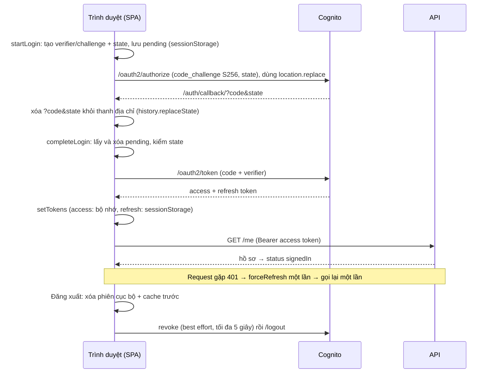

# B2 — Đăng nhập Cognito ở frontend

Frontend là Next.js static export, đăng nhập Cognito bằng Authorization Code + PKCE (không client secret). Phía API xem `docs/a3-auth.md`; quyền thật luôn do API kiểm tra, `AuthGate` chỉ là UX.

## Cấu hình

| Biến môi trường | Bắt buộc | Ý nghĩa |
|---|---|---|
| `NEXT_PUBLIC_COGNITO_DOMAIN` | Có | Domain Cognito Managed Login, phải bắt đầu bằng `https://` (dạng `https://<prefix>.auth.<region>.amazoncognito.com`) |
| `NEXT_PUBLIC_COGNITO_CLIENT_ID` | Có | App Client dùng cho frontend |
| `NEXT_PUBLIC_API_BASE_URL` | Không | Ghi đè địa chỉ API khi chạy local với backend riêng; mặc định `/api/v1` cùng origin |

Các biến `NEXT_PUBLIC_*` được nhúng vào bundle lúc build, nên đổi giá trị phải build lại. Thiếu hoặc sai định dạng (domain không phải `https://`) thì `getAuthConfig` trả `null` và giao diện hiện thông báo cấu hình thiếu, không đăng nhập được.

Cách đặt khi chạy local, từ thư mục `frontend`:

```powershell
Copy-Item .env.example .env.local
# Sửa .env.local, điền giá trị thật do người phụ trách Cognito/OPS cung cấp
npm run dev
```

`.env.local` đã bị `.gitignore` bỏ qua; chỉ `.env.example` (giá trị giả) được commit. Giá trị thật lấy từ Parameter Store/OPS, không ghi vào repo, chat hay ảnh chụp. App Client phải khai báo đúng Callback URL `<origin>/auth/callback/` và Sign-out URL `<origin>/` cho từng môi trường (local và domain thật), scope `openid email profile`.

## Luồng xử lý



Quy tắc chính:

1. **Lưu trữ**: access token chỉ trong bộ nhớ; refresh token trong `sessionStorage["exammaker.auth.refresh"]`; dữ liệu đăng nhập tạm (state, verifier, trang cần quay lại) trong `sessionStorage["exammaker.auth.pending"]`, dùng một lần rồi xóa. Không `localStorage`, không đưa token vào URL/log. Không lưu và không dùng ID token, không dùng `nonce`. Mỗi tab một phiên riêng (mở tab mới phải đăng nhập lại).
2. **Quay lại đúng trang**: `AuthGate` ghi lại đường dẫn hiện tại (pathname + query + hash) khi bắt đầu đăng nhập; sau callback `sanitizeReturnTo` chỉ chấp nhận đường dẫn tương đối cùng origin (chặn open redirect, và không quay lại chính `/auth/callback`).
3. **Làm mới chủ động**: khi access token còn ≤ 5 phút (`REFRESH_MARGIN_MS = 300_000`). Nhiều nơi cùng cần token thì chỉ một lần gọi token endpoint (single-flight). Mỗi lần gọi `/oauth2/token` (đổi code hoặc làm mới) bị giới hạn `TOKEN_REQUEST_TIMEOUT_MS = 10_000` (10 giây, gồm cả đọc body); hết giờ thì request bị hủy với lỗi `TimeoutError`, nên kết nối treo không làm trang callback "Đang tải" mãi và lần làm mới dùng chung được giải phóng để thử lại.
4. **Khi làm mới lỗi**: chỉ 4xx dứt khoát từ token endpoint (trừ 429, ví dụ `invalid_grant`) mới xóa phiên và chuyển `signedOut`. Lỗi mạng (kể cả hết thời gian chờ), 429, 5xx giữ phiên; token đang có vẫn được dùng đến khi hết hạn. Đang `signedIn` mà refresh token đã mất khỏi `sessionStorage` (vd người dùng xóa dữ liệu trang) thì lần làm mới kế tiếp xóa phiên và chuyển `signedOut`, không giữ một phiên không thể phục hồi.
5. **401 từ API**: làm mới một lần và gọi lại đúng một lần. Làm mới trả `null` (refresh token mất hoặc bị từ chối) → `signedOut` → tự đăng nhập lại. Làm mới được mà gọi lại vẫn 401 (user chưa tạo, bị khóa...) → trang `denied` hướng dẫn liên hệ quản trị viên, không tự đăng nhập lại, nên không có vòng lặp. 403 không đụng đến phiên.
6. **Đăng xuất**: chuyển `loggingOut` trước → đọc refresh token → `clearSession` → xóa cache TanStack Query → thu hồi refresh token với thời gian chờ tối đa 5 giây (`AbortSignal.timeout(5000)`; lỗi hoặc hết giờ thì bỏ qua) → điều hướng tới `/logout` của Cognito. Phiên cục bộ bị xóa trước khi gọi mạng, nên mạng chậm không làm treo đăng xuất lâu và reload giữa chừng không khôi phục phiên. Trong lúc `loggingOut`, `AuthProvider` bỏ qua sự kiện phiên để `AuthGate` không tự đăng nhập lại.
7. **Callback**: trang callback đọc `code`/`state` rồi xóa ngay query khỏi thanh địa chỉ và lịch sử (`history.replaceState` về `/auth/callback/`) trước khi đổi code, với mọi kết quả. Mở `/auth/callback/` mà không có dữ liệu tạm (bookmark, tab mới), sai `state`, thiếu `code`, có `error=...` từ Cognito hoặc đổi code thất bại đều hiện thông báo tiếng Việt kèm nút thử lại, không tự lặp. Nút thử lại đăng nhập lại với trang cần quay lại ban đầu nếu dữ liệu tạm còn (`LoginCallbackError.returnTo`, đã qua `sanitizeReturnTo`), nếu không thì về `/`. Effect của trang callback chỉ chạy một lần kể cả khi React StrictMode chạy hai lần.
8. **Nút Back và bfcache**: chuyển sang trang đăng nhập Cognito dùng `location.replace` (không `assign`), nên trang đang rời không thành đích của nút Back; riêng đăng xuất vẫn dùng `location.assign`. Trang được trình duyệt khôi phục từ back/forward cache (`pageshow` với `persisted = true`) giữ nguyên trạng thái React cũ (vd `loggingOut` hoặc đang chuyển sang đăng nhập) nên `AuthProvider` tải lại toàn trang; phiên được dựng lại từ `sessionStorage`.

## Các file và hàm chính

| File | Hàm/thành phần | Tác dụng |
|---|---|---|
| `src/lib/auth/config.ts` | `getAuthConfig`, `redirectUri`, `logoutUri` | Đọc cấu hình build-time (trả `null` nếu thiếu/sai), tính `redirect_uri` và `logout_uri` từ origin hiện tại |
| `src/lib/auth/pkce.ts` | `createPkcePair`, `createCodeChallenge`, `createState`, `randomUrlSafe`, `base64UrlEncode` | Sinh `code_verifier`, `code_challenge` S256 và `state` ngẫu nhiên bằng Web Crypto |
| `src/lib/auth/return-to.ts` | `sanitizeReturnTo` | Chỉ cho quay lại đường dẫn tương đối cùng origin, chặn open redirect và vòng lặp về callback |
| `src/lib/auth/cognito.ts` | `buildAuthorizeUrl`, `buildLogoutUrl`, `exchangeCode`, `refreshTokens`, `revokeToken`, `TokenEndpointError` | Dựng URL authorize/logout, gọi `/oauth2/token` và revoke; lỗi token endpoint mang mã và status HTTP |
| `src/lib/auth/session.ts` | `setTokens`, `clearSession`, `forceRefresh`, `getValidAccessToken`, `restoreSession`, `installAccessTokenProvider`, `subscribeSession`, `getStatus` | Giữ access token trong bộ nhớ, refresh token trong `sessionStorage`; làm mới single-flight; trạng thái `unknown/signedIn/signedOut/denied` |
| `src/lib/auth/login.ts` | `startLogin`, `completeLogin`, `LoginCallbackError` | Bắt đầu đăng nhập (lưu pending, chuyển sang Cognito bằng `location.replace`); xử lý callback: kiểm state/code, đổi token, trả trang cần quay lại; lỗi callback mang `returnTo` khi còn dữ liệu tạm |
| `src/lib/auth/auth-context.tsx` | `AuthProvider`, `useAuth`, `isPublicPath` | Ghép phiên với `GET /me`; cung cấp `status`, `me`, `login`, `logout`, `retry`, `hasRole`; tải lại trang khi khôi phục từ bfcache; `/auth/callback` là trang công khai |
| `src/lib/api/auth-middleware.ts` | `createAuthMiddleware` | Middleware openapi-fetch: gắn Bearer, xử lý 401 (refresh một lần, gọi lại một lần, vẫn 401 thì `denied`); được đăng ký trong `src/lib/api/client.ts` |
| `src/app/auth/callback/page.tsx` | `CallbackPage` | Trang đích của Cognito, gọi `completeLogin` một lần rồi chuyển về trang cũ hoặc hiện lỗi |
| `src/components/auth-gate.tsx` | `AuthGate` | Quyết định hiển thị theo trạng thái: tự chuyển sang đăng nhập khi `signedOut`, trang `denied`, lỗi mạng kèm thử lại, thiếu cấu hình |
| `src/components/user-menu.tsx` | `UserMenu` | Hiển thị người dùng và nút đăng xuất |
| `scripts/inject-csp.mjs` | `main`, `buildCsp`, `hashInlineScripts`, `injectCsp` | Chèn CSP meta vào mọi trang HTML sau `next build` |

Chuỗi giao diện nằm ở `src/messages/vi.ts` (nhóm `auth`); comment kỹ thuật trong code bằng tiếng Anh.

## CSP sinh lúc build

`npm run build` chạy `next build` rồi `node scripts/inject-csp.mjs`. Script nạp `.env*` bằng `@next/env` (giống `next build`), duyệt mọi file `.html` trong `out/`, băm sha256 từng script inline mà Next sinh ra và chèn `<meta http-equiv="Content-Security-Policy">` ngay sau thẻ `<meta charSet>` (nếu không có thì ngay sau `<head>`). Vì hash tính riêng cho từng trang nên `script-src` không cần `'unsafe-inline'`/`'unsafe-eval'`. Script thất bại (HTML đã có CSP, không có `<head>`) sẽ làm build lỗi.

Chính sách sinh ra (`<hash...>` là các hash sha256 của script inline trong trang đó; `<cognito-origin>` và `<api-origin>` lấy từ biến môi trường, chỉ giữ phần origin; `NEXT_PUBLIC_API_BASE_URL` dạng đường dẫn tương đối được bỏ qua vì đã thuộc `'self'`):

```text
default-src 'self';
script-src 'self' <hash...>;
style-src 'self' 'unsafe-inline';
img-src 'self' data:;
font-src 'self';
connect-src 'self' <cognito-origin> <api-origin>;
object-src 'none';
base-uri 'self';
form-action 'self' <cognito-origin>
```

(Thực tế nằm trên một dòng, các directive ngăn bằng `; `.) `style-src 'unsafe-inline'` cần cho style inline của Next và KaTeX. `next dev` không chạy script này nên không có CSP; muốn kiểm CSP phải build rồi phục vụ thư mục `out/`.

Meta CSP không hỗ trợ `frame-ancestors`, nên O5 cần thêm CloudFront Response Headers Policy trên behavior `/*`:

| Header | Giá trị đề xuất |
|---|---|
| `Content-Security-Policy` | `frame-ancestors 'none'` |
| `Strict-Transport-Security` | `max-age=31536000; includeSubDomains` |
| `X-Content-Type-Options` | `nosniff` |
| `Referrer-Policy` | `strict-origin-when-cross-origin` |

Policy header chỉ có `frame-ancestors` nên không xung đột với CSP trong meta (trình duyệt áp dụng giao của các policy).

## Kiểm thử tự động

Từ `frontend`:

```powershell
npm run api:check; npm run lint; npm run typecheck; npm test; npm run build
```

Unit test (Vitest) phủ PKCE, `sanitizeReturnTo`, token endpoint, phiên (single-flight, lỗi tạm thời, lỗi dứt khoát, mất refresh token), `completeLogin`, middleware 401, `AuthProvider`/`AuthGate` (đăng xuất, bfcache), trang callback (kể cả StrictMode, dọn URL, thử lại giữ trang cũ) và `inject-csp`. `src/lib/auth/auth-flow.integration.test.tsx` ghép các module thật (session, login, API client + middleware, `AuthProvider`, `AuthGate`, trang callback), chỉ giả `fetch`, điều hướng và biến môi trường: user bị khóa ra trang `denied` mà không tự đăng nhập lại, và callback đổi code → `/me` → quay về đúng trang. Các test này dùng mock, không chạm Cognito thật.

## Checklist smoke test Cognito thật

Người phụ trách chạy với User Pool/App Client thật và một user nội bộ đã có trong DB (bootstrap/A4). Điền cột "Kết quả" (Đạt/Không đạt, ngày, người chạy). Không ghi token, mật khẩu, callback chứa authorization code hay định danh AWS thật.

| # | Kiểm tra | Kết quả |
|---|---|---|
| 1 | Mở một trang bảo vệ (vd `/exams/view/?id=x`) khi chưa đăng nhập → chuyển sang Cognito; đăng nhập xong quay về đúng trang đó | |
| 2 | Refresh (F5) giữa chừng khi đã đăng nhập → vẫn còn phiên, không bị hỏi đăng nhập lại | |
| 3 | Access token mất khỏi bộ nhớ hoặc gần/đã hết hạn (reload sau khi đợi hoặc ép hết hạn) → tự làm mới bằng refresh token, người dùng không bị đá ra | |
| 4 | Khóa user trong DB (`is_active=false`) rồi gọi API → trang `denied` hướng dẫn liên hệ quản trị viên, không tự đăng nhập lại; mở khóa lại sau khi thử | |
| 5 | Đăng xuất → về Cognito `/logout` rồi `/`; bấm Back không vào lại được trang bảo vệ mà không đăng nhập | |
| 6 | Sửa tham số `state` trên URL callback (`/auth/callback/?code=...&state=sai`) → thông báo lỗi tiếng Việt + nút thử lại, không vòng lặp | |
| 7 | Mở `/auth/callback/` trực tiếp (không qua đăng nhập) → thông báo lỗi + nút thử lại | |
| 8 | Mở DevTools Console tại `/`, `/auth/callback/`, `/exams/view/?id=x` trên bản build (không phải `next dev`) → không có lỗi `Refused to ...` do CSP | |
| 9 | Mở tab mới cùng site → phải đăng nhập lại (mỗi tab một phiên); tab cũ vẫn dùng bình thường | |
| 10 | DevTools > Application: `localStorage` không chứa token; `sessionStorage` chỉ có `exammaker.auth.refresh` (và `exammaker.auth.pending` thoáng qua khi đang đăng nhập) | |
| 11 | Sau khi đăng nhập xong, thanh địa chỉ và lịch sử không còn `?code=...&state=...`; ở trang đăng nhập Cognito bấm Back → không kẹt ở "Đang chuyển tới trang đăng nhập…" hay "Đang tải…" | |

Smoke test chạy với bản build local hoặc domain thật; kiểm tra E2E qua CloudFront chỉ làm được sau O5. Chỉ tick B2 trong `docs/tasks.md` sau khi PR được merge và CI xanh.
