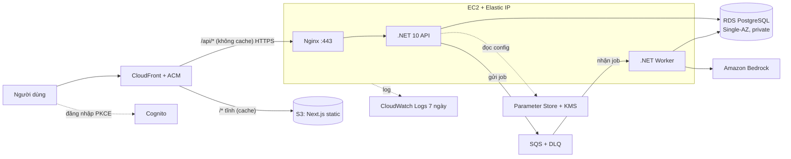

# AI Exam Maker — Project Context

> **Phiên bản 0.17** — làm rõ state machine, phân quyền, API và dữ liệu (xem "Lịch sử thay đổi" cuối file). File này là ngữ cảnh chung của dự án (cho cả team và các AI coding agent). Khi đổi quyết định kiến trúc/nghiệp vụ, **sửa file này trước rồi mới code**.
> Mục đánh dấu **[GIẢ ĐỊNH]** là chỗ đang tạm chốt, cần team xác nhận (xem mục 14). Các quyết định đã chốt nằm ở cuối mục 14.

---

## 1. Tổng quan

**AI Exam Maker** là web app giúp giáo viên THPT (Việt Nam) soạn đề thi bằng AI:

1. Giáo viên dùng AI sinh **câu hỏi / bộ câu hỏi** theo môn, khối, chương, dạng câu, mức độ nhận thức.
2. Câu hỏi được **lưu vào ngân hàng câu hỏi** để tái sử dụng.
3. Giáo viên **ghép đề thi** từ ngân hàng câu hỏi.
4. **Tổ trưởng chuyên môn** duyệt đề.
5. **Admin** chọn đề (phiên bản đã duyệt) được đưa vào sử dụng chính thức cho thi cử.

Đây là đồ án cuối khóa FCJ/FCAJ, triển khai trên AWS.

**Ràng buộc quan trọng**

- Ngân sách **$200 AWS credit** cho toàn bộ dự án (dev + demo). Đây là **hạn mức ngân sách, không phải cơ chế tự ngắt dịch vụ**: AWS Budgets chỉ cảnh báo, không chặn chi tiêu. Phải có quota ngay trong ứng dụng (đặc biệt cho Bedrock). Không mặc định $200 chắc chắn đủ — xem mục 6.
- Chỉ dùng dịch vụ AWS thuộc phạm vi chương trình FCAJ. **Không ALB, không NAT Gateway, không Multi-AZ**; chấp nhận đánh đổi về tính sẵn sàng.
- Ngôn ngữ giao diện: **tiếng Việt**. Code, tên biến/bảng, commit: tiếng Anh.

---

## 2. Phạm vi & luồng demo chính

### 2.1 Luồng demo chính (ưu tiên số 1, mọi thứ khác phục vụ luồng này)

```
Teacher đăng nhập → sinh câu hỏi bằng AI (async) → rà soát/sửa → lưu ngân hàng → gửi duyệt câu
 → Head duyệt câu (Approved) → ghép đề từ câu Approved → gửi tổ trưởng
 → Head duyệt đề (Approved) → Admin publish → xem/xuất đề học sinh & file đáp án
```

### 2.2 MVP (bắt buộc)

- Đăng nhập Cognito, 3 vai trò, phân quyền theo tổ chuyên môn
- Sinh câu hỏi bằng AI **theo môn/khối/chương/dạng/mức độ + ghi chú yêu cầu thêm dạng văn bản ngắn** (chưa upload tài liệu)
- Ngân hàng câu hỏi + quy trình duyệt câu hỏi
- Ghép đề, **phiên bản đề + snapshot**, quy trình duyệt đề, publish
- Xuất đề: bản **học sinh** (không đáp án) và bản **đáp án/lời giải** (cho giáo viên)
- Audit log, quota AI, giám sát cơ bản
- Dạng câu hỏi MVP: `MultipleChoice` bắt buộc; `TrueFalse`, `ShortAnswer` làm tiếp nếu kịp; `Essay` để sau. Data model hỗ trợ đủ 4 dạng ngay từ đầu để khỏi đổi schema.

### 2.3 Sau MVP

- Upload tài liệu (SGK/đề cũ) làm ngữ cảnh cho AI (RAG đơn giản)
- Ma trận đề + sinh đề tự động, nhiều mã đề (xáo câu/đáp án)
- Xuất DOCX; thống kê dùng AI; phát hiện câu trùng

### 2.4 Ngoài phạm vi

Tổ chức thi trực tuyến, chấm điểm tự động. "Đưa vào thi cử" = đề được đánh dấu **Published** và xuất file; không phát đề/nhận bài của học sinh trên hệ thống.

---

## 3. Vai trò & phân quyền

| Vai trò   | Cognito group | Mô tả                                                                                                                                 |
| --------- | ------------- | ------------------------------------------------------------------------------------------------------------------------------------- |
| Giáo viên | `teacher`     | Sinh câu hỏi AI, quản lý câu hỏi/đề của mình, gửi duyệt                                                                               |
| Tổ trưởng | `head`        | Quyền giáo viên + duyệt/từ chối câu hỏi và đề trong **tổ chuyên môn của mình**                                                        |
| Quản trị  | `admin`       | Quản lý người dùng/tổ/môn; publish/unpublish đề; xem audit log, thống kê AI; duyệt thay khi cần. **Không** tạo nội dung (câu hỏi, đề) |

### 3.1 Quy tắc chung

- Mỗi user có đúng **một vai trò** và **một tổ chuyên môn** (admin không bắt buộc thuộc tổ).
- **Không ai được duyệt nội dung do chính mình tạo.** Nếu người tạo là tổ trưởng → duyệt bởi **tổ trưởng khác cùng tổ**; nếu tổ không có tổ trưởng khác → **admin** duyệt thay.
- Quyền kiểm tra ở backend (policy theo role + tổ + ownership). Frontend chỉ ẩn/hiện UI.
- **Nguồn sự thật phân quyền là DB** (xem 3.3), không chỉ dựa vào claim trong token.

### 3.2 Ma trận quyền chi tiết

| Hành động                                                                             | Teacher                            | Head                             | Admin                   |
| ------------------------------------------------------------------------------------- | ---------------------------------- | -------------------------------- | ----------------------- |
| Sinh câu hỏi bằng AI (trong quota)                                                    | ✓                                  | ✓                                | –                       |
| Xem câu hỏi `Draft`/`Rejected`                                                        | của mình                           | của mình                         | tất cả (chỉ xem)        |
| Sửa/xóa câu hỏi `Draft`/`Rejected` của mình (xóa chỉ khi chưa được đề nào tham chiếu) | ✓                                  | ✓                                | –                       |
| Gửi duyệt / rút lại câu hỏi của mình (`Draft`/`Rejected` → `Submitted`)               | ✓                                  | ✓                                | –                       |
| Đánh dấu "Đã rà soát" câu AI của mình (`mark-reviewed`)                               | ✓                                  | ✓                                | –                       |
| Archive câu hỏi `Approved`                                                            | của mình                           | của mình hoặc cùng tổ | tất cả                  |
| Duyệt/từ chối câu hỏi                                                                 | –                                  | ✓ (cùng tổ, không phải của mình) | ✓ (không phải của mình) |
| Xem câu hỏi `Approved`                                                                | cùng tổ                            | cùng tổ                          | tất cả                  |
| Tạo đề, ghép câu (của mình hoặc `Approved` cùng tổ)                                   | ✓                                  | ✓                                | –                       |
| Gửi duyệt / rút lại phiên bản đề của mình (`Draft`/`Rejected` → `Submitted`)          | ✓                                  | ✓                                | –                       |
| Tạo phiên bản mới từ đề đã có (của mình)                                              | ✓                                  | ✓                                | –                       |
| Duyệt/từ chối phiên bản đề                                                            | –                                  | ✓ (cùng tổ, không phải của mình) | ✓ (không phải của mình) |
| Publish / Unpublish phiên bản đề `Approved`                                           | –                                  | –                                | ✓                       |
| Archive phiên bản đề `Approved`/`Rejected`                                            | của mình                           | cùng tổ                          | tất cả                  |
| Đọc danh mục môn/chương/tổ (`GET /subjects`, `/topics`, `/departments`)               | ✓                                  | ✓                                | ✓                       |
| Xuất đề học sinh                                                                      | đề của mình & đề Published cùng tổ | như teacher                      | tất cả                  |
| Xuất **file đáp án/lời giải**                                                         | đề của mình                        | đề trong tổ                      | tất cả                  |
| Quản lý user, tổ, môn, chương                                                         | –                                  | –                                | ✓                       |
| Xem audit log / thống kê AI                                                           | –                                  | log trong tổ                     | tất cả                  |

### 3.3 Đồng bộ Cognito ↔ PostgreSQL

- **Tắt tự đăng ký** (self sign-up) trên User Pool. Admin tạo user qua API: gọi `AdminCreateUser` + `AdminAddUserToGroup` rồi ghi bảng `users` (có `cognito_sub`); nếu bước nào lỗi thì rollback/đền bù bước đã làm.
- `users` trong DB là nguồn sự thật cho **role, department_id, is_active**. Cognito group chỉ là bản sao để cổng thô; API luôn đọc user từ DB theo `sub` (cache ngắn 1–5 phút) rồi mới áp policy.
- Đổi vai trò/tổ: cập nhật DB **và** group Cognito; có hiệu lực ngay ở API vì API dựa vào DB. Token cũ vẫn hợp lệ đến hết hạn nhưng không đủ để vượt quyền DB.
- Vô hiệu hóa user: `is_active=false` + `AdminDisableUser` + `AdminUserGlobalSignOut`.
- Access token TTL ngắn (~60 phút); sau khi đăng nhập mà `sub` chưa có trong `users` → từ chối (không tự cấp quyền).
- Job đối soát (admin chạy tay hoặc định kỳ): so group Cognito với `users.role`, báo lệch.
- **Admin đầu tiên (bootstrap)**: vì self sign-up tắt, admin đầu tiên được tạo bằng script/lệnh chạy một lần bởi người triển khai (tạo user Cognito + group `admin` + dòng `users`), không qua API công khai. Ghi quy trình vào `docs/`.
- **Đăng nhập lần đầu / mật khẩu**: admin tạo user với mật khẩu tạm → user phải đổi mật khẩu ở lần đăng nhập đầu (dùng giao diện đăng nhập của Cognito, Managed Login); có luồng quên mật khẩu. Đổi email phải cập nhật cả Cognito và `users.email`.

#### Chi tiết triển khai A3

- API chỉ nhận Cognito **access token**: kiểm chữ ký RS256/JWKS, issuer, exp/nbf, `token_use=access`, `client_id` đúng App Client và `sub` không rỗng. Access token Cognito dùng `client_id` để kiểm client; không nhầm với `aud` của ID token. ID token không dùng gọi API.
- Sau khi xác thực token, tải `users` bằng unique `cognito_sub`; user không tồn tại, bị khóa hoặc hồ sơ role/tổ không hợp lệ trả 401. Không tự tạo user. Principal ứng dụng được tạo lại từ DB, loại bỏ role/group tùy ý trong token.
- Cache 1 phút chỉ dành cho email/họ tên/tên tổ hiển thị. `id`, role, department_id, is_active luôn đọc DB trong mỗi request để đổi quyền/khóa tài khoản có hiệu lực ở request kế tiếp. Không cache kết quả user không tồn tại. Principal/current user chỉ sống trong request.
- Policy dùng chung: Admin (quản trị), ContentAuthor (teacher/head), SameDepartment (cùng tổ hoặc admin), Owner (teacher/head sở hữu), Reviewer (head cùng tổ hoặc admin, luôn cấm tự duyệt). Resource policy yêu cầu đối tượng có creator/department từ DB; không nhận dữ liệu quyền từ body client. Các use case sau A3 phải kiểm tra trạng thái/quyền cụ thể theo ma trận 3.2.
- Quy tắc quyền thuần nằm ở Application để use case và API dùng chung. Tự duyệt trả 403 `SelfReview`; các lỗi quyền khác trả `Forbidden`. Controller kiểm resource policy phải chuyển kết quả qua `ToForbiddenProblem(HttpContext)` để giữ mã lỗi.
- Mặc định endpoint yêu cầu user nội bộ hợp lệ; `/health` công khai. `GET /api/v1/me` trả đúng schema Me trong OpenAPI. 401/403 trả ProblemDetails với code/traceId; 401 có WWW-Authenticate: Bearer.
- Cấu hình Cognito lấy từ môi trường/Parameter Store. Nếu chưa cấu hình thì health vẫn chạy, mọi Bearer token bị từ chối; cấu hình một phần hoặc sai định dạng làm startup thất bại. Triển khai thật phải cung cấp đủ Region/UserPoolId/ClientId. Test dùng khóa RSA tạm và discovery giả trong test host, không có chế độ giả xác thực ở production.

#### Chi tiết triển khai A4

- API quản lý user chỉ dành cho admin. Kiểm lại quyền admin trong DB khi giữ khóa ghi, không cho admin tự hạ vai trò hoặc tự khóa. Các thao tác ghi/bootstrap dùng khóa advisory transaction PostgreSQL chung để tránh trùng email và ghi đè đồng bộ giữa nhiều process.
- Email được trim/lowercase; unique index trên lower(btrim(email)). Bổ sung users.created_at UTC theo schema AdminUser; user cũ lấy thời điểm migration vì không có lịch sử tạo chính xác.
- Tạo user: Cognito tạo mật khẩu tạm và gửi email mời, thêm group, sau đó lưu DB. API không nhận/trả mật khẩu. Lỗi trước commit sẽ xóa tài khoản Cognito vừa được thao tác này tạo; không xóa tài khoản đã tồn tại. Nếu kết quả commit không rõ ràng thì không xóa Cognito tự động, báo cần đối soát.
- Sửa user: đọc snapshot Cognito theo sub và kiểm sub khớp, đồng bộ thuộc tính và đúng một group ứng dụng; giữ nguyên group ngoài teacher/head/admin. Khi lỗi trước commit, khôi phục snapshot bằng token hủy độc lập có timeout. Lỗi commit không rõ ràng không tự đảo trạng thái, báo cần đối soát.
- Khóa user là thao tác fail-closed: commit is_active=false trong DB trước khi Disable/GlobalSignOut. Nếu Cognito lỗi, giữ DB bị khóa và báo lỗi; retry khóa sẽ thử lại các thao tác AWS. Không tự mở khóa user khi đền bù. Đổi role/email kèm khóa cần thực hiện sau khi khóa đã được lưu; lỗi đồng bộ không khôi phục quyền truy cập cũ.
- Tạo/sửa/khóa user ghi audit_logs cùng transaction với thay đổi DB; bootstrap dùng actor NULL và note nêu công cụ.
- Reconcile chỉ đọc và báo lệch role/trạng thái/thiếu user hai phía, có phân trang AWS; không tự sửa. Bootstrap admin chạy qua công cụ CLI riêng, chỉ cho phép khi chưa có admin trong DB, không có API bootstrap công khai.
- Admin chịu trách nhiệm xác nhận quyền sở hữu email mới trước khi cập nhật; thao tác quản trị đặt email_verified=true để email được cập nhật ngay, tránh DB/Cognito dùng hai email khác nhau. Không sử dụng cơ chế này cho tự sửa hồ sơ của người dùng.

- Giới hạn A4: mỗi lệnh AWS async tối đa 5 giây bằng CancellationToken, không tự retry SDK; toàn thao tác tối đa 20 giây, cleanup độc lập tối đa 5 giây; chờ lock DB tối đa 2 giây và trả Conflict khi bận. Đây là giới hạn hợp tác theo cancellation, không bảo đảm cứng khi mạng/driver không phản hồi hủy. Client phải kiểm tra lại DB/reconcile trước khi retry sau timeout.
- AWS client singleton được tạo lazy. Create gọi AdminCreateUser rồi AdminAddUserToGroup, không cập nhật lại profile vừa tạo. Bootstrap tách IAdminBootstrapper và chỉ đăng ký trong CLI. Audit sửa user ghi role/tổ trước-sau, không ghi email. Log lỗi chứa loại lỗi/mã AWS hoặc SQL/stack, bỏ raw message để tránh lộ dữ liệu nhạy cảm.

#### Chi tiết triển khai A5

- Sửa review A5: tên chuẩn hóa NFC, từ chối ký tự điều khiển; kiểm độ dài sau trim. Endpoint đọc chỉ bind bộ lọc được khai báo cho endpoint đó, bỏ qua query key ngoài hợp đồng. Audit xóa lưu metadata trước khi xóa.
- Job AI Queued/Running bảo vệ môn/chương trong params: cấm xóa hoặc đổi tổ của môn, đổi môn/khối của chương đang được job sử dụng (409). Tạo job dùng shared advisory lock 48683402 và kiểm lại catalog trong transaction trước giữ quota; ghi catalog dùng exclusive lock cùng khóa, tránh race giữa kiểm tồn tại và commit job. Danh mục đổi sau validation ban đầu trả 400, không tiêu quota hoặc enqueue.

- Danh sách tổ/môn/chương dành cho mọi người dùng đã xác thực; chỉ admin được tạo/sửa/xóa. Không giới hạn danh sách theo tổ của người đọc, đúng ma trận 3.2.
- Phân trang mặc định 1/20, tối đa 100 phần tử; tên được trim, không nhận tên chỉ có khoảng trắng. Giữ phạm vi unique hiện có: tên tổ toàn cục, tên môn trong tổ, tên chương trong môn/khối (phân biệt hoa/thường theo PostgreSQL).
- Sửa/xóa bản ghi không tồn tại trả 404; parent không tồn tại hoặc đầu vào không hợp lệ trả 400. Trùng unique hoặc vi phạm FK RESTRICT khi xóa/chuyển tổ/môn/khối trả 409, không tự sửa dữ liệu tham chiếu.
- Ghi danh mục dùng cùng advisory transaction lock với A4 (chờ tối đa 2 giây), kiểm lại admin active trong DB sau khi giữ lock. Thay đổi và audit Create/Update/Delete theo entity Department/Subject/Topic được commit cùng transaction; lỗi không để lại audit thành công.
- Sắp xếp tổ/môn theo tên rồi id; chương theo khối, sortOrder rồi id để phân trang ổn định. Bộ lọc không khớp trả trang rỗng. Không gọi AWS cho thao tác danh mục.

---

## 4. Luồng nghiệp vụ

### 4.1 Sinh câu hỏi bằng AI (bất đồng bộ)

```
Teacher gửi yêu cầu → API kiểm tra quota → tạo AIGenerationJob(Queued) + gửi SQS {jobId}
 → Worker nhận → claim job (idempotent) → gọi Bedrock → parse + validate JSON → (tuỳ chọn) bước kiểm chứng đáp án
 → lưu Question(Draft, source=AI) + cập nhật job trong 1 transaction → xóa message SQS
 → Frontend polling GET /ai/jobs/{id} → Teacher rà soát từng câu
```

#### 4.1.1 Worker: chống xử lý trùng & phục hồi

SQS standard queue giao **at-least-once** nên có thể giao lại cùng message. Quy tắc bắt buộc:

- **Idempotency theo `jobId`**: claim bằng cập nhật có điều kiện trong DB, nếu 0 dòng bị ảnh hưởng thì bỏ qua message:
  `UPDATE jobs SET status='Running', attempt=attempt+1, lease_expires_at=now()+@lease WHERE id=@id AND attempt<@max AND (status='Queued' OR (status='Running' AND lease_expires_at<now()))`
- Job đã `Succeeded`/`Failed` → xóa message, không làm gì.
- **Chống ghi trùng**: câu sinh ra có khóa duy nhất `(ai_job_id, ordinal)`; lưu kết quả + đổi trạng thái job trong **một transaction**; chỉ xóa message SQS **sau khi commit**.
- **Visibility timeout** = **300 giây (5 phút)** (chốt ở O11) > thời gian xử lý tối đa (timeout Bedrock × số lần thử trong một lần nhận, kể cả bước kiểm chứng đáp án khi bật ở demo); nếu vượt hoặc tiệm cận 300s, worker (B6) bắt buộc gia hạn bằng heartbeat `ChangeMessageVisibility`.
- **Giới hạn retry**: `maxReceiveCount` = 3 rồi chuyển **DLQ**; `max_attempts` trong DB khớp con số này.
- **Phân loại lỗi**:
  - _Retryable_ (throttling, timeout, 5xx Bedrock, lỗi mạng) → không xóa message; SQS standard **không tự có backoff**, nên worker gọi `ChangeMessageVisibility` để tăng dần thời gian chờ (vd 30s → 120s → 300s) trước khi message được giao lại.
  - _Non-retryable_ (JSON hỏng sau N lần "sửa lại", vi phạm schema, nội dung bị từ chối) → đánh dấu `Failed` + lý do, xóa message, **không** tiêu thêm token.
- **Phục hồi job treo**: tác vụ định kỳ (trong worker) tìm job `Running` có `lease_expires_at` đã qua → đưa về `Queued` (nếu còn lượt) hoặc `Failed`.
- **Chống mất message khi enqueue**: API tạo job trong DB rồi mới gửi SQS; nếu gửi lỗi, job kẹt `Queued`. Tác vụ định kỳ tìm job `Queued` quá N phút → **gửi lại message** (an toàn vì worker idempotent theo `jobId`); quá M phút vẫn không chạy → cảnh báo.
- **Prompt**: template prompt nằm trong code, có số phiên bản; job lưu `prompt_version` + `model_id`. Ghi chú của người dùng chèn vào prompt được coi là **không tin cậy** (có thể chứa prompt injection) — chỉ đóng vai trò dữ liệu, luôn qua validate schema, kết quả vẫn là `Draft`.
- Ghi token vào job **theo từng lần gọi** để tính đúng chi phí kể cả khi retry.

#### 4.1.2 Kiểm tra độ chính xác của AI

AI có thể sai kiến thức/đáp án, nên đầu ra **luôn là `Draft` và bắt buộc có người duyệt**. Thêm các lớp kiểm tra:

1. **Validate cấu trúc** theo schema từng dạng (mục 8.2): đủ phương án, đúng 1 đáp án (trắc nghiệm), đúng 4 ý (đúng/sai), v.v.
2. **Kiểm chứng độc lập (tùy chọn, cấu hình bật/tắt vì tốn token; chỉ áp dụng cho `MultipleChoice`, `TrueFalse`, `ShortAnswer` — `Essay` không so sánh tự động được)**: gọi model lần hai chỉ để _tự giải_ câu hỏi (không cho xem đáp án) rồi so với đáp án gốc → lưu `ai_verification` = `Agree` / `Disagree` / `NotChecked`. `Disagree` → gắn cờ "cần xem kỹ".
3. **Loại trùng**: so sánh nội dung chuẩn hóa với câu đã có trong cùng môn/chương (MVP: so khớp chuỗi; sau đó mới dùng embedding).
4. **Checklist của người duyệt** hiển thị ở màn hình duyệt: đáp án đúng? lời giải khớp? đúng chương/mức độ? công thức hiển thị đúng?
5. Teacher phải bấm **"Đã rà soát"** trên câu do AI sinh trước khi được gửi duyệt.

#### Chi tiết triển khai B3

- Lõi AI nằm ở `Application/Ai/Generation`, thuần logic, không gọi AWS. Worker (B6) dùng `AiQuestionGenerator` cho một lần xử lý job; triển khai Bedrock thật của `IAiModelClient` thuộc B6, test dùng fake có kịch bản.
- **Prompt**: template trong code, phiên bản `AiPromptBuilder.Version` (hiện `question-gen-v1`), đổi nội dung/schema prompt thì phải tăng version; job lưu `prompt_version` và `model_id` từ kết quả. Prompt chỉ chứa tên môn/chương và tham số job, không có dữ liệu cá nhân. Ghi chú giáo viên và tên danh mục được mã hóa thành chuỗi JSON (escape `"`, `\`, ký tự điều khiển, `<`, `>`, `&`), ghi chú nằm trong khối `<teacher_note>` và system prompt quy định khối này chỉ là dữ liệu, không đổi được quy tắc, định dạng, số câu, dạng, chương hay mức độ.
- **Schema đầu ra**: một object `{"questions":[...]}`, mỗi phần tử đúng các khóa `stem`, `payload`, `explanation` (tùy chọn, chuỗi hoặc null); khóa thừa/thiếu/trùng là vi phạm. Chấp nhận bọc trong một khối ```` ```json ```` duy nhất; không chấp nhận comment, dấu phẩy thừa hay văn bản ngoài JSON. Số câu phải **đúng bằng** số câu yêu cầu. Dạng/mức độ lấy từ yêu cầu job, không lấy từ model.
- Mỗi câu kiểm bằng cùng `QuestionRules.Validate` (gồm `QuestionPayloadRules` mục 8.2) như câu tạo tay: chuẩn hóa stem/explanation, giới hạn 10000 ký tự, payload đúng dạng được yêu cầu. Câu hợp lệ nhận `ordinal` từ 1 theo thứ tự trả về, dùng cho khóa `(ai_job_id, ai_ordinal)`.
- **Sửa lại (repair)**: JSON hỏng hoặc sai schema → gửi tiếp trong cùng hội thoại thông điệp lỗi do parser sinh (vị trí lỗi như `questions[1].payload`, không trích nội dung model), tối đa `AiGeneration:MaxRepairAttempts` lần (mặc định 1). Vẫn sai → `Failed` với `InvalidJson`/`SchemaViolation`. Model dừng do giới hạn token → `OutputTruncated`, bị lọc nội dung → `ContentRefused`; hai trường hợp này không sửa lại. Mặc định `MaxOutputTokens` 8192, `Temperature` 0.7, cấu hình ở mục `AiGeneration`.
- **Token theo từng lần gọi**: generator gọi callback sau **mọi** lần gọi model hoàn tất (kể cả đầu ra bị loại) để worker cộng dồn token vào job/`ai_usage_daily`; callback ném lỗi (ví dụ vượt trần token ngày) thì dừng, không gọi tiếp.
- **Phân loại lỗi** (`AiErrorClassifier`): retryable gồm `Throttled`, `Timeout` (kể cả hủy/timeout HTTP), `ServiceUnavailable`, `NetworkError` và `Unknown` (giới hạn bởi `maxReceiveCount`, sau đó vào DLQ); non-retryable gồm `InvalidRequest`, `AccessDenied`, `ContentRefused`, `InvalidJson`, `SchemaViolation`, `OutputTruncated`. Adapter Bedrock phải ánh xạ lỗi SDK sang `AiModelException` theo loại. `error_message` của job là câu tiếng Việt cố định theo mã lỗi, không chứa nội dung lỗi gốc hay đầu ra model.
- **Backoff** (`AiRetryPolicy`): sau lần thử 1/2/≥3 đặt visibility 30/120/300 giây, không vượt visibility timeout 300 giây của hàng đợi.

### 4.2 Vòng đời câu hỏi

```
Draft ──submit──→ Submitted ──approve──→ Approved ──archive──→ Archived
  ↑                 │    │                   │
  └───withdraw──────┘    └─reject→ Rejected  └─ sửa nội dung → Draft (revision+1)
                                    │
                                    └─ sửa rồi submit lại → Submitted
```

- `Draft`: đang soạn (cá nhân). `Submitted`: chờ duyệt, khóa sửa; người tạo chỉ có thể **rút lại** (`withdraw` → `Draft`). `Approved`: dùng được cho cả tổ. `Rejected`: có `review_note`; người tạo **sửa được** và `submit` lại trực tiếp (không cần qua `Draft`). `Archived`: ngừng dùng, không khôi phục trong MVP (muốn dùng lại thì nhân bản thành câu mới).
- Sửa nội dung câu `Approved` → quay về `Draft` và tăng `revision` (câu `Submitted` thì phải rút lại trước); các đề **đã snapshot** không bị ảnh hưởng (mục 4.3).
- **Xóa**: chỉ xóa được câu `Draft`/`Rejected` **chưa được đề nào tham chiếu**; câu đã `Approved` thì dùng `Archive`, không xóa.
- Mọi chuyển trạng thái ghi `AuditLog`.

#### Chi tiết triển khai A6

- UpdatedAt của thay đổi thực sự được chuẩn hóa theo micro giây PostgreSQL và tăng ít nhất 1 micro giây so với mốc đã lưu; thao tác no-op giữ nguyên timestamp. Thiếu submittedAt được kiểm trong service sau quyền và trạng thái, không dùng Required ở DTO review; lỗi định dạng JSON vẫn do MVC xử lý trước action.
- Giữ chặn sửa/archive khi đề Draft/Rejected/Submitted tham chiếu. Lỗi 409 QuestionReferenced trả references (totalItems và tối đa 20 items: examId, versionId, status, createdBy.id/fullName) để liên hệ chủ đề gỡ câu; không lộ tiêu đề/nội dung đề hoặc email, chỉ trả sau kiểm quyền nhìn thấy/thao tác trên câu.
- Approve/reject câu hỏi và contract A7 bắt buộc gửi submittedAt đã đọc. So UTC tới mili giây để hỗ trợ JavaScript Date; lượt submit mới lưu đúng mili giây và vượt mốc mili giây của sự kiện trước, nên hai lượt gửi cách nhau ít nhất 1ms dù cùng giờ hệ thống. Thiếu trả 400 errors[submittedAt], lệch lượt trả 409 Conflict; không thay trạng thái/audit. Quyền và trạng thái được kiểm trước token lượt duyệt. Frontend phải đọc lại sau Conflict, không tự thay token rồi retry.
- Points và tolerance dùng chung bộ kiểm số JSON: số mũ tường minh trong [-1000, 1000], dạng thập phân PostgreSQL sẽ lưu tối đa 1024 ký tự (kể cả dấu và dấu chấm). Không giới hạn theo độ dài token khoa học ban đầu; nội dung đã nhận phải vẫn validate được sau jsonb chuẩn hóa. Points > 0, tolerance >= 0, không làm tròn qua decimal. Explanation trim/blank thành null trước kiểm giới hạn 10000 ký tự; vẫn cấm NUL.
- Đọc câu không khóa và kiểm CanRead trước FOR UPDATE; sau khi khóa phải reload và kiểm lại quyền. Câu riêng tư của người khác trả 404 ngay cả khi hàng đang bị khóa, không trả 409 theo tình trạng khóa.

- Model validation và lỗi binding dùng key JSON camelCase (stem/type/subjectId/grade), bỏ tiền tố $. của JSON path. Create kiểm actor live và role trước validation nghiệp vụ; lỗi bind MVC vẫn được kiểm trước action. Điểm rubric Essay kiểm dương trên số JSON gốc, không làm tròn qua decimal, nên số dương rất nhỏ vẫn hợp lệ theo OpenAPI.

- API dùng schema A2, không thêm migration. State machine, quyền và payload ở Application; transaction và khóa ở Infrastructure. Creator teacher/head được tạo/sửa/xóa/submit/withdraw/mark-reviewed; admin chỉ đọc, duyệt thay và archive theo ma trận 3.2.
- Teacher/head đọc câu của mình kể cả Archived, hoặc Approved cùng tổ; head còn đọc Submitted cùng tổ để duyệt. Admin đọc tất cả. GET và endpoint ghi che câu ngoài phạm vi bằng 404 trước kiểm quyền/trạng thái. Hàng đợi chỉ head/admin, loại câu của mình, sắp submittedAt tăng dần.
- Department câu cố định theo môn lúc tạo, phải thuộc tổ tác giả. Sửa chỉ chọn môn/chương cùng department cố định và đúng khối. PUT kiểm trạng thái trước validation/catalog; Submitted phải withdraw, Archived không khôi phục.
- So nội dung sau chuẩn hóa stem trim, explanation trim và blank thành null, payload theo cấu trúc JSON. PUT không đổi nội dung giữ nguyên trạng thái/revision/AI flags/updatedAt và không ghi audit. Sửa Approved mở Draft và revision+1; sửa Draft/Rejected giữ trạng thái/revision. Sửa nội dung AI reset rà soát, kiểm chứng và note.
- Khi đề Draft/Rejected/Submitted tham chiếu câu, chặn đổi môn/chương/khối, sửa nội dung làm Approved mở lại và archive bằng 409 QuestionReferenced. Submitted có thể withdraw/reject nên cần bảo vệ nguồn như đề đang sửa. Khóa các phiên bản tham chiếu FOR SHARE tới commit. Chỉ có tham chiếu Approved/Published/Archived thì cho sửa/archive nguồn, giữ nguyên snapshot.
- Archive chỉ từ Approved: teacher/head được archive câu của mình kể cả sau chuyển tổ; head còn được archive câu cùng tổ, admin tất cả. Kiểm quyền và trạng thái trước kiểm tham chiếu đề.
- DELETE chỉ cho creator xóa Draft/Rejected khi không có exam_version_questions tham chiếu. Tự gỡ question_set_items kể cả bộ người khác; ghi audit QuestionSet cho từng bộ thực sự mất liên kết và DeleteQuestion trong cùng transaction. Lỗi phải rollback câu, liên kết và audit.
- Mỗi ghi giữ FOR SHARE trên hàng user của actor, đọc lại active/role/tổ, sau đó shared catalog lock 48683402 và FOR UPDATE trên câu tới commit; không dùng khóa quản trị toàn cục A4. Actor mất/bị khóa trả 401 Unauthorized kèm WWW-Authenticate: Bearer; hợp lệ nhưng thiếu quyền trả 403. lock_timeout 2 giây, deadlock/lock timeout trả 409 Conflict.
- A7 khi thêm item phải giữ FOR SHARE trên câu nguồn trong cùng transaction trước kiểm Approved/revision/môn/khối và chèn liên kết, phối hợp với FOR UPDATE của A6; không thả khóa trước khi chèn.
- Payload đúng bốn dạng, không cho giả mạo creator/provenance/trạng thái hoặc field ngoài hợp đồng. Text tối đa 10000 ký tự; acceptedAnswers/rubric tối đa 20 phần tử; surrogate lẻ trả 400 errors[payload]. Số ShortAnswer chỉ dạng -?[0-9]+([.,][0-9]+)?, giữ nguyên chuỗi; không khoảng trắng, dấu cộng, số mũ, NaN/Infinity. Options theo A–D, statements a–d.
- Submit xóa quyết định cũ và đặt submittedAt; withdraw xóa submittedAt và quyết định. Approve/reject ghi reviewer/reviewedAt, chỉ hai action này dùng ReviewNote trong audit; reject bắt buộc note. Admin/head không tự duyệt (403 SelfReview). Mọi thay đổi cùng audit dùng UTC; câu mới có createdAt = updatedAt.
- AI phải mark-reviewed trước submit. Retry mark-reviewed đã true là no-op sau kiểm quyền/trạng thái, không đổi updatedAt hoặc ghi audit. Schema QuestionApproveRequest/QuestionRejectRequest từ chối field thừa, độc lập với contract exam-version A7; submit/approve khai báo cả response 400 ValidationFailed.

### 4.3 Đề thi: phiên bản & snapshot

`Exam` là "danh tính" của đề; nội dung và trạng thái nằm ở **`ExamVersion`**.

```
ExamVersion:
Draft ──submit──→ Submitted ──approve──→ Approved ──publish──→ Published
  ↑                 │    │                 │  ↑                  │
  └───withdraw──────┘    └─reject→ Rejected│  └────unpublish─────┘
                                  │        └──archive──→ Archived  (từ Approved/Rejected)
                                  └─ sửa rồi submit lại → Submitted
```

- `Draft`: người tạo chọn/sắp xếp câu hỏi, đặt điểm. Nội dung hiển thị là nội dung **hiện tại** của câu hỏi nguồn (giữ revision của câu Approved bằng guard A6; cảnh báo revision chỉ dành cho liên kết cũ hoặc dữ liệu import). Khi ghép có thể chọn câu của mình hoặc câu `Approved` cùng tổ, **nhưng khi `Submit` mọi câu phải đang `Approved`** (duyệt đề không thay cho duyệt câu).
- **Khi gửi duyệt (`Submit`) → đóng băng**: sao chép **nội dung, đáp án, lời giải, điểm, dạng, mức độ** của từng câu vào `exam_version_questions` (snapshot) kèm `source_question_id`, `source_revision`; tính `content_hash` của cả phiên bản. Từ `Submitted` trở đi **không sửa được**.
- Muốn sửa: người tạo **rút lại** (`Submitted → Draft`) trước khi có quyết định, hoặc **tạo phiên bản mới** (`POST /exams/{id}/versions`) sao chép từ phiên bản cũ.
- `Rejected` luôn kèm lý do; người tạo **sửa được** (phiên bản được mở khóa), rồi `submit` lại trực tiếp — mỗi lần `Submit` lại **chụp snapshot mới** và tính lại `content_hash`. Hoặc tạo phiên bản mới.
- `Published`: admin chọn. **Bất biến.** `Unpublish` đưa phiên bản về `Approved` (thu hồi, vẫn lưu lịch sử trong `audit_logs`; **không** có trạng thái `Unpublished` riêng). Một đề có tối đa **một phiên bản Published** tại một thời điểm; publish phiên bản khác khi đã có bản `Published` bị **từ chối (409)** — admin phải `Unpublish` bản cũ trước.
- `Archived`: dành cho phiên bản `Approved`/`Rejected` không dùng nữa; không khôi phục trong MVP. Trigger DB chặn mọi chuyển từ Archived sang trạng thái khác; cập nhật metadata không thuộc nội dung vẫn phải giữ nguyên trạng thái Archived.
- Xuất đề luôn lấy từ **snapshot**, không đọc câu hỏi gốc.

#### Chi tiết triển khai A7

- Nội dung nguồn hiện tại trong Draft/Rejected phải qua QuestionRules.CanRead theo từng câu. Item không được đọc giữ metadata liên kết/điểm, còn type/difficulty/stem/payload/explanation/currentSourceRevision trả null với warning SourceContentUnavailable; không tiết lộ đáp án qua đề. Head/admin vẫn xem được metadata phiên bản theo ma trận. Tác giả chuyển tổ giữ quyền ghép/submit nguồn Approved trong tổ cố định của đề, không dùng tổ hiện tại của actor để đổi phạm vi đề cũ.
- Ngoại lệ cho tác giả chuyển tổ: trong chính đề cũ của mình, vẫn xem được nguồn Approved đủ điều kiện CanSelect theo tổ cố định của đề. Ngoại lệ không áp dụng cho nguồn Draft/Rejected riêng của người khác và không mở quyền GET trực tiếp câu hỏi ngoài tổ.
- Archive Rejected giữ nguyên snapshot và hash đang lưu như A2, không chụp thêm nội dung nguồn riêng tư. Item thiếu snapshot trả nội dung null và warning SnapshotUnavailable; không thay bằng nguồn hiện tại. ContentHash trên response luôn null khi Draft/Rejected hoặc snapshot chưa đầy đủ; hash trong DB vẫn giữ lịch sử tới lần submit lại.
- Tạo Exam kèm phiên bản Draft số 1, thời gian mặc định 45 phút. Môn/khối/tổ cố định; chỉ tác giả teacher/head được đổi tiêu đề, ghép câu và tạo phiên bản mới. Không tạo thêm khi còn Draft; bản mới sao chép liên kết từ phiên bản được chọn trong cùng Exam (mặc định mới nhất), dùng revision/nội dung nguồn hiện tại; bỏ nguồn Archived hoặc không còn phù hợp/quyền chọn và trả warnings. Rejected vẫn cho phép tạo bản mới.
- Tạo/sửa danh sách tối đa 200 câu, không trùng nguồn; điểm decimal dương, tổng không tràn decimal. Draft được rỗng; Submit bắt buộc có câu. Mỗi câu được chọn phải thuộc tác giả hoặc Approved cùng tổ, đúng môn/khối/tổ đề, không Archived. Khi Submit tất cả phải Approved; lưu snapshot toàn bộ nội dung và SHA-256 canonical JSON gồm duration, thứ tự, điểm, source id/revision và nội dung. Không đưa thời gian/người duyệt vào hash.
- Mutation giữ khóa hàng actor FOR SHARE và catalog shared 48683402; khóa Exam FOR UPDATE trước ExamVersion để serialize tạo số phiên bản và publish. Khóa nguồn FOR SHARE theo id trước kiểm lại quyền/trạng thái/phân loại và ghi liên kết/snapshot, giữ tới commit. A6 có thứ tự khóa nguồn rồi phiên bản nên deadlock có thể xảy ra; rollback và trả 409, không tự retry mutation. Chờ khóa tối đa 2 giây.
- Đọc/ghi kiểm visibility trước khóa rồi kiểm lại sau khóa. Admin thấy tất cả; head thấy đề cùng tổ hoặc của mình; teacher thấy đề của mình và metadata phiên bản Published cùng tổ. Chi tiết chứa đáp án chỉ tác giả/head cùng tổ/admin; teacher đọc phiên bản Published của người khác nhận 403, không lộ phiên bản riêng tư qua list/detail. Xuất đề thuộc B10.
- Quyền/trạng thái được kiểm trước token duyệt, kể cả body rỗng; submittedAt bắt buộc trong service, so UTC mili giây và mỗi lượt submit tăng tối thiểu 1ms. UpdatedAt tăng theo micro giây; mọi thay đổi và audit nằm trong cùng transaction. Approve/reject cấm tự duyệt, reject cần note. Withdraw xóa snapshot/hash/quyết định sau khi mở Draft; Rejected dùng nội dung nguồn hiện tại trong phạm vi quyền xem và chụp lại ở lần submit sau. Archive Rejected giữ dữ liệu hiện có theo A2 và khóa nội dung như các bản Archived khác.
- Publish/unpublish chỉ admin; từ Approved/Published tương ứng, giữ snapshot/hash và metadata lịch sử publish; bản Published khác trong cùng đề gây 409 PublishedVersionExists. Archive chỉ Approved/Rejected, tác giả/head cùng tổ/admin, không khôi phục. Không thay đổi schema A2.

### 4.4 Xuất đề

Hai loại file riêng, **không bao giờ trộn**:

- **Đề học sinh**: chỉ đề bài (không đáp án, không lời giải), có header (trường, môn, thời gian, mã đề). Trong MVP **mã đề = `exam_versions.version_no`** (chưa có nhiều mã đề xáo thứ tự).
- **Đáp án/lời giải cho giáo viên**: đáp án, lời giải, thang điểm/rubric. Quyền truy cập chặt hơn (mục 3.2).

Công thức Toán/Lý/Hóa dùng LaTeX/KaTeX. **Cách xuất MVP**: trang xem trước có CSS in, xuất PDF bằng trình duyệt (KaTeX hiển thị đúng, không cần server dựng công thức). **DOCX** (cần chuyển LaTeX→công thức Word) để sau MVP. Vì vậy MVP chưa bắt buộc bucket S3 cho file xuất.

---

## 5. Kiến trúc AWS

### 5.1 Sơ đồ



### 5.2 Dịch vụ & vai trò

| Dịch vụ                                                   | Vai trò                                                                                            |
| --------------------------------------------------------- | -------------------------------------------------------------------------------------------------- |
| CloudFront + S3 + ACM                                     | Host frontend (Next.js **static export**); HTTPS cho domain; cổng vào cho `/api/*` → EC2           |
| Cognito                                                   | User Pool, 3 group; phát JWT; self sign-up **tắt**                                                 |
| EC2 (`t4g.small`, ARM64) + EBS 30 GB + Elastic IP         | Nginx + .NET 10 API + Worker (BackgroundService đọc SQS) cùng máy                                  |
| RDS PostgreSQL (`db.t4g.micro`, Single-AZ)                | Dữ liệu nghiệp vụ; private subnet, chỉ SG của EC2 truy cập                                         |
| SQS (+ DLQ)                                               | Hàng đợi job AI                                                                                    |
| S3                                                        | Bucket frontend (qua OAC); bucket tài liệu/file xuất (sau MVP), private + presigned URL            |
| IAM                                                       | Instance profile EC2, least privilege (SQS, Bedrock, SSM, Cognito Admin\*, S3 nếu dùng)            |
| KMS                                                       | Mã hóa; **ưu tiên key do AWS quản lý** (aws/ssm, aws/rds, aws/s3) để không phát sinh phí key riêng |
| Parameter Store                                           | Connection string, ModelId, cấu hình quota, ID Cognito, origin secret                              |
| CloudWatch (retention 7 ngày)                             | Log, alarm, metric (mục 10)                                                                        |
| **Amazon Bedrock**                                        | LLM sinh câu hỏi — khoản chi phí biến đổi lớn nhất, tính riêng ở mục 6                             |

### 5.3 CloudFront → EC2 (đã chốt, 19/11/2026)

Không dùng ALB, nên kết nối này phải tự bảo mật:

- **Domain bắt buộc**: cần một domain có thể tạo bản ghi DNS. Frontend: `app.<domain>` (alias CloudFront). Origin API: `origin.<domain>` → A record trỏ **Elastic IP** (CloudFront yêu cầu origin là hostname, không dùng IP trần).
- **HTTPS ở origin**: Nginx trên EC2 terminate TLS cho `origin.<domain>` bằng chứng chỉ **Let's Encrypt** (certbot). CloudFront origin: **Origin protocol = HTTPS only**, domain khớp chứng chỉ (CloudFront kiểm tra chứng chỉ origin, **không** chấp nhận self-signed). Gia hạn tự động bằng certbot timer. ACM chỉ dùng cho chứng chỉ phía CloudFront (phải ở us-east-1).
  - Let's Encrypt HTTP-01 cần port 80 mở ra internet khi cấp/gia hạn: mở **80** chỉ để phục vụ challenge + trả lỗi cho request khác; **443** chỉ cho CloudFront. (Hoặc DNS-01 nếu DNS có API.)
- **Security Group EC2**: 443 chỉ từ **managed prefix list của CloudFront** (`com.amazonaws.global.cloudfront.origin-facing`); lưu ý prefix list này chiếm nhiều dòng quota rule của SG — kiểm tra quota trước. SSH đóng; quản trị bằng SSM Session Manager.
- **Chặn gọi trực tiếp vào origin**: CloudFront thêm **custom origin header** bí mật (vd `X-Origin-Verify: <secret>`, lưu Parameter Store); Nginx từ chối request thiếu/sai header.
- **Behavior `/api/*`**:
  - Allowed methods: `GET, HEAD, OPTIONS, PUT, POST, PATCH, DELETE`.
  - Cache policy: **`CachingDisabled`** — không cache dữ liệu riêng tư.
  - Origin request policy: **custom policy bắt buộc**; chuyển tiếp `Authorization`, query và
    các header API cần thiết, đặc biệt `CloudFront-Viewer-Address`; **không chuyển tiếp
    `Host`** để khớp chứng chỉ/`server_name` của origin. Không dùng managed policy thay thế
    nếu chưa xác minh policy đó có `CloudFront-Viewer-Address`.
  - Origin read timeout mặc định đủ vì tác vụ AI chạy async; không cho API request dài.
  - Nginx đặt `X-Forwarded-For/Proto`; .NET bật `ForwardedHeaders` và chỉ tin Nginx.
- **Behavior frontend**: S3 origin qua OAC. Behavior mặc định `/*` dùng cache policy HTML
  ngắn (min `0`, default `60`, max `300` giây) và CloudFront Function rewrite route. Hai
  behavior `/_next/static/*` và `/assets/*` dùng cache policy asset lâu (TTL tối đa
  `31536000` giây) cho file có hash trong tên. Invalidate khi deploy.
- Một domain cho cả web và API → không cần cấu hình CORS phức tạp.

### 5.4 Các quyết định kiến trúc khác

1. **Next.js static export** (`output: 'export'`): không SSR, Server Actions, middleware, ISR; toàn bộ dữ liệu qua REST API phía client. Chi tiết routing ở mục 9.
2. **API + Worker chung máy**, tách project trong code (`ExamMaker.Worker`) để sau tách deploy dễ. Giới hạn bộ nhớ từng process (`t4g.small` chỉ 2 GB RAM).
3. **EC2 ở public subnet, RDS ở private subnet, không NAT Gateway** (NAT tốn phí đáng kể so với $200). Đã chọn `t4g` (ARM) nên build `linux-arm64`.
4. **Secrets/config chỉ qua Parameter Store**, EC2 dùng instance profile, không dùng access key.
5. **Auth**: Authorization Code + PKCE với Cognito; API validate JWT (issuer, audience/client id, hết hạn) rồi tải user từ DB (mục 3.3).
6. **Hạ tầng dựng qua Console + script trong `/infra`** (Nginx, systemd, CloudFront Function, bootstrap) kèm runbook trong `docs/`; không chứa ID/ARN thật. IaC hoàn chỉnh để sau MVP.

---

## 6. Ngân sách AWS ($200)

> Đơn giá tra cứu từ **AWS Pricing Calculator** (On-Demand tại region **`ap-southeast-1` — Singapore**; không dựa vào Free Tier 12 tháng của tài khoản mới để đảm bảo an toàn, chỉ tính mức _Always Free_ cho CloudFront/Cognito/SQS).

**Bộ giả định tính toán:**

- **Region & Thời gian:** `ap-southeast-1` (Singapore) · **2 tháng** (giai đoạn dev + demo).
- **Lịch vận hành máy chủ:** Bật EC2 và RDS từ **07:00 đến 23:00 hàng ngày (16 giờ/ngày ≈ 480 giờ/tháng)**, tắt ban đêm 23:00–07:00.
- **Quy mô & Quota AI:** ≤ 20 người dùng đồng thời (~30 tài khoản giáo viên demo) · quota tối đa **10 lần sinh/user/ngày** (tối đa 10 câu/lần).
- **Ước lượng Bedrock:** Trung bình 1 job (5–10 câu + bước kiểm chứng đáp án `ai_verification` + hệ số retry 1.2×) tiêu thụ **~4,000 input tokens + ~4,000 output tokens**. Kết hợp **Claude 3.5 Haiku** ($0.80/1M input, $4.00/1M output → ~$0.0192/job) cho ~500 jobs/tháng quá trình dev/test và **Claude 3.5 Sonnet v2** ($3.00/1M input, $15.00/1M output → ~$0.072/job) cho ~100 jobs/tháng demo chính.

| Hạng mục                                   | Cách tính                                                                                       | Chi phí/tháng (USD)                            | Số tháng | Tổng               |
| ------------------------------------------ | ----------------------------------------------------------------------------------------------- | ---------------------------------------------- | -------- | ------------------ |
| EC2 (`t4g.small`, 2 vCPU, 2 GB)            | $0.0212/giờ × 480 giờ (07:00–23:00)                                                             | $10.18                                         | 2        | $20.36             |
| EBS `gp3` 30 GB                            | 30 GB × $0.096/GB-tháng                                                                         | $2.88                                          | 2        | $5.76              |
| IPv4 công khai / Elastic IP                | 1 EIP × $0.005/giờ × 730 giờ (tính cả khi dừng EC2)                                             | $3.65                                          | 2        | $7.30              |
| RDS PostgreSQL (`db.t4g.micro`, Single-AZ) | $0.020/giờ × 480 giờ (07:00–23:00)                                                              | $9.60                                          | 2        | $19.20             |
| RDS storage (`gp3` 20 GB) + backup         | 20 GB × $0.138 + 5 GB manual snapshot × $0.095 (auto backup ≤ 20 GB free; trần autoscaling max 40 GB) | $3.24                                          | 2        | $6.48              |
| CloudFront                                 | Always Free (≤ 1 TB data out + 10M HTTPS requests/tháng; demo < 10 GB)                          | $0.00                                          | 2        | $0.00              |
| S3                                         | ≤ 5 GB × $0.025/GB + ~50,000 PUT/GET requests                                                   | $0.40                                          | 2        | $0.80              |
| Cognito                                    | Always Free (≤ 10,000 MAU; quy mô dự án < 100 user)                                             | $0.00                                          | 2        | $0.00              |
| SQS (+ DLQ)                                | Always Free (≤ 1,000,000 requests/tháng; worker long-polling 20s ~260k reqs)                    | $0.00                                          | 2        | $0.00              |
| CloudWatch (log 7 ngày, alarm, metric)     | 5 GB log + 10 alarm/metric đầu free; dự trù vượt nhẹ log/metric                                 | $1.50                                          | 2        | $3.00              |
| Domain / Route 53                          | Hosted zone $0.50 + queries $0.40/tháng (+ phí domain ~$10.00/năm tính 1 lần)                   | $0.90 (+ $10 một lần)                          | 2        | $11.80             |
| **Bedrock**                                | 4k in + 4k out tokens/job: 500 jobs Dev (Haiku: $9.60) + 100 jobs Demo (Sonnet v2: $7.20)/tháng | $16.80                                         | 2        | $33.60             |
| **Dự phòng**                               | **≥ 20% ngân sách $200 (22.5%)** — bù khi chạy lố giờ hoặc tăng lượt gọi AI                     | —                                              | —        | **$45.00**         |
| **Tổng**                                   | Hạ tầng ($74.70) + Bedrock ($33.60) + Dự phòng ($45.00)                                         | **$49.15/tháng** (+ $10 domain & $45 dự phòng) | 2        | **$153.30 ≤ $200** |

> _Ghi chú độ an toàn:_ Ngay cả trong trường hợp cao điểm chạy **24/7 (730 giờ/tháng)** suốt cả 2 tháng không tắt máy (EC2 +$10.60, RDS +$10.00) hoặc chọn `t3.small` (x86, +$4.98), tổng chi phí toàn dự án kể cả $45.00 dự phòng vẫn chỉ ở mức **$174.54–$179.52 ≤ $200.00**.

**Kiểm soát chi phí (nhiều lớp, vì Budgets không tự ngắt):**

- AWS Budgets cảnh báo ở các mốc (vd 50% / 80% / 100%) gửi email cho cả nhóm.
- **Quota ngay trong ứng dụng**: giới hạn số câu/lần, số lần sinh/ngày/user, tổng token/ngày toàn hệ thống; vượt quota → API từ chối trước khi vào hàng đợi. Cấu hình quota ở Parameter Store.
- Model nhỏ/rẻ cho dev; bước kiểm chứng đáp án bật/tắt bằng cấu hình.
- **Tắt EC2/RDS khi không dùng** (lưu ý RDS tự khởi động lại sau 7 ngày dừng).
- Dọn tài nguyên sau demo: snapshot, EBS rời, Elastic IP không gắn.

---

## 7. Tech stack

| Tầng     | Công nghệ                                                                                                           |
| -------- | ------------------------------------------------------------------------------------------------------------------- |
| Frontend | **Next.js** (App Router, TypeScript, static export), Tailwind CSS, TanStack Query, React Hook Form + Zod, **KaTeX** |
| Backend  | **.NET 10** (LTS), ASP.NET Core Web API, EF Core + Npgsql, validation thuần ở Application, Serilog → CloudWatch |
| CSDL     | PostgreSQL, EF Core migrations                                                                                      |
| AWS SDK  | SQS, SimpleSystemsManagement, BedrockRuntime, CognitoIdentityProvider (admin)                                       |
| CI/CD    | GitHub Actions (mục 11)                                                                                             |

Cấu trúc repo (monorepo):

```
/frontend                Next.js
/backend
  /src
    ExamMaker.Api            endpoints, auth, DI
    ExamMaker.Application    use case, DTO, validation, state machine
    ExamMaker.Domain         entity, enum, quy tắc nghiệp vụ
    ExamMaker.Infrastructure EF Core, SQS, Bedrock, SSM, Cognito admin
    ExamMaker.Worker         BackgroundService xử lý job AI
  /tests
/infra                   script/IaC triển khai
/docs                    context.md, ERD, API spec
```

---

## 8. Mô hình dữ liệu

### 8.1 Bảng chính

- **users**: id, cognito_sub (unique), email (unique theo lower/btrim), full_name, role, department_id, is_active, created_at
- **departments** (tổ chuyên môn): id, name · tổ trưởng = các `users` có `role='head'` và `department_id` của tổ (một tổ có thể có nhiều tổ trưởng; không cần bảng riêng)
- **subjects**: id, name, department_id · **topics** (chương): id, subject_id, grade (10/11/12), name, `sort_order` (tránh dùng từ khóa SQL `order` làm tên cột)
- **questions**: id, subject_id, topic_id, **department_id** (lưu cố định lúc tạo, dùng cho phân quyền "cùng tổ"), grade, **type**, difficulty, **stem** (Markdown+LaTeX), **payload** (jsonb, theo dạng — mục 8.2), explanation, **status**, **revision**, source (`AI`/`Manual`), ai_job_id, ai_ordinal, **ai_verification** (`NotChecked/Agree/Disagree` + note), ai_reviewed_by_author (bool), created_by, submitted_at, reviewed_by, reviewed_at, review_note, timestamps
  - unique `(ai_job_id, ai_ordinal)` chống ghi trùng khi worker chạy lại
  - `difficulty`: `Recognition`, `Understanding`, `Application`, `HighApplication`
  - CHECK: `type` thuộc enum; `payload` không null; Application kiểm tra sâu bằng các hàm thuần theo từng dạng (QuestionRules/QuestionPayloadRules), không dùng FluentValidation. MVC chỉ kiểm binding/DataAnnotations, chuẩn hóa key lỗi theo tên JSON camelCase.
- **question_sets** + **question_set_items**: bộ câu hỏi của giáo viên
- **exams**: id, title, subject_id, grade, department_id, created_by
- **exam_versions**: id, exam_id, **version_no**, status, duration_minutes, total_points, content_hash, submitted_at, reviewed_by, reviewed_at, review_note, published_by, published_at · unique `(exam_id, version_no)`; partial unique index: tối đa 1 version `Published` / exam
- **exam_version_questions**: exam_version_id, `sort_order`, points, **source_question_id**, **source_revision**, và (đóng băng khi Submit) **type, difficulty, stem_snapshot, payload_snapshot, explanation_snapshot** · sau `Submitted` chỉ đọc (chặn ở tầng app **và** trigger/ràng buộc nếu kịp)
- **ai_generation_jobs**: id, requested_by, params (jsonb), status (`Queued/Running/Succeeded/Failed`), attempt, max_attempts, lease_expires_at, error_code, error_message, model_id, prompt_version, input_tokens, output_tokens (cộng dồn), created_at, started_at, finished_at
- **ai_usage_daily** (quota): user_id, date, jobs, tokens
- **audit_logs**: id, actor_id, entity_type (`Question/ExamVersion/User/AiJob/...`), entity_id, department_id, action, from_status, to_status, note, created_at

#### Chi tiết triển khai A2

- `question_sets` dùng `name`, `created_by`; `question_set_items` dùng PK `(question_set_id, question_id)` và index `question_id`. Giữ FK RESTRICT theo yêu cầu A2: xóa các liên kết trong cùng transaction trước khi xóa bộ hoặc câu Draft/Rejected đủ điều kiện. Không tự xóa câu khi xóa bộ.
- `exam_version_questions` giữ PK `(exam_version_id, sort_order)` và unique `(exam_version_id, source_question_id)`. Khi đổi thứ tự, Application khóa version bằng `SELECT ... FOR UPDATE`, xóa các item rồi chèn lại thứ tự mới trong cùng transaction; không cập nhật trực tiếp khóa đang được EF theo dõi. Trigger chỉ cho phép thay đổi item khi version ở Draft/Rejected, khóa hàng version cha để tuần tự hóa với Submit.
- Snapshot được phép NULL ở Draft/Rejected. Khi đóng băng để duyệt/xuất bản (Submitted/Approved/Published), trigger bắt buộc có ít nhất một câu, đủ type/difficulty/stem/payload và content_hash; explanation có thể NULL vì câu nguồn không bắt buộc lời giải. Trigger kiểm tra tổng points bằng total_points. Khi Submit từ Draft/Rejected, câu nguồn phải Approved, revision và nội dung snapshot phải khớp nguồn. Application chụp snapshot và tính hash trước khi đổi trạng thái trong cùng transaction. DB khóa nội dung item và duration/total_points/hash của version đã đóng băng; rút về Draft hoặc bị từ chối mở khóa theo mục 4.3. Withdraw/reject chỉ đổi trạng thái và thông tin duyệt, giữ nguyên hash, điểm và thời lượng trong câu lệnh chuyển trạng thái; chỉ sửa nội dung sau khi đã về Draft/Rejected, rồi tính lại hash ở lần Submit sau. Archive từ Rejected không yêu cầu snapshot đầy đủ hoặc câu nguồn còn Approved/đúng revision: giữ nguyên dữ liệu hiện có và khóa item/metadata khi đã Archived. Hash được tính/kiểm tra theo thuật toán thống nhất ở Application.
- `points` và `total_points` dùng PostgreSQL `numeric`, ánh xạ C# `decimal`. Thời gian dùng `timestamp with time zone` và UTC; `exams`, `exam_versions` có `created_at`, `updated_at` theo API contract.
- `ai_usage_daily` dùng PK `(user_id, date)`, ngày UTC; token là `bigint`. `audit_logs.entity_id` là UUID không có FK đa hình. `audit_logs.department_id` (nullable, không FK, index `(department_id, created_at)`) là snapshot tổ chuyên môn tại thời điểm ghi sự kiện để phạm vi `GET /audit-logs` của Head giữ nguyên kể cả khi actor chuyển tổ hoặc thực thể bị xóa; dòng có `department_id` NULL chỉ Admin xem được, và mọi nơi ghi audit mới phải chủ động set `DepartmentId` (nếu quên set, Head sẽ không bao giờ thấy dòng đó). `actor_id` nullable: NULL biểu thị hệ thống và bắt buộc note nêu tác vụ (worker/reconcile); actor người dùng giữ FK RESTRICT. Entity type gồm Question, Exam, ExamVersion, QuestionSet, User, AiJob, Department, Subject, Topic; API trả actor=null cho hệ thống.
- Toàn bộ FK dùng RESTRICT. Composite FK `(subject_id, department_id)` đảm bảo câu/đề thuộc đúng tổ của môn; `(topic_id, subject_id, grade)` đảm bảo câu thuộc đúng chương/môn/khối. Chuyển tổ/môn/khối của catalog đang được tham chiếu sẽ bị chặn; Application phải xử lý di chuyển dữ liệu một cách có chủ đích.
- `users.department_id` bắt buộc với teacher/head. Câu AI bắt buộc có job và ordinal >= 1; câu Manual phải để cả hai NULL. Published bắt buộc người/thời điểm publish và hash; Rejected bắt buộc lý do. Running bắt buộc lease; job kết thúc bắt buộc finished_at; Failed có error_code không rỗng, Succeeded không có error_code.
- Application phải kiểm tra cùng môn/khối/tổ với đề ngay khi thêm item ở Draft/Rejected và có test cho use case ghép đề; trigger kiểm tra lại khi Submit. Phân quyền, toàn bộ state machine, ghi audit tự động và cập nhật quota đồng thời thuộc các task nghiệp vụ sau A2. Integration test trong repo dùng PostgreSQL thật, database tạm độc lập, chạy bắt buộc trong CI qua PostgreSQL service.

### 8.2 Cấu trúc `payload` theo dạng câu hỏi

| `type`           | `payload`                                                                                          | Quy tắc                                      |
| ---------------- | -------------------------------------------------------------------------------------------------- | -------------------------------------------- |
| `MultipleChoice` | `{ "options":[{"label":"A","text":"…"},…4], "correctLabel":"B" }`                                  | đúng 4 phương án, đúng 1 đáp án đúng         |
| `TrueFalse`      | `{ "statements":[{"label":"a","text":"…","isTrue":true},…4] }`                                     | đúng 4 ý a–d, mỗi ý có đúng/sai              |
| `ShortAnswer`    | `{ "answerType":"number\|text", "acceptedAnswers":["12","12,0"], "unit":"m/s", "tolerance":0.01 }` | ≥ 1 đáp án chấp nhận; `tolerance` chỉ cho số |
| `Essay`          | `{ "modelAnswer":"…", "rubric":[{"criterion":"…","points":1.0}] }`                                 | tổng điểm rubric = điểm câu                  |

`payload_snapshot` của đề copy nguyên khối này khi Submit.

### 8.3 Ràng buộc dữ liệu cần đảm bảo

- Khi ghép (`Draft`): chỉ gồm câu của người tạo hoặc `Approved` cùng tổ, cùng môn/khối với đề. Khi `Submit`: mọi câu phải `Approved`.
- Tổng điểm các câu = `total_points` của phiên bản. Điểm dùng kiểu `numeric`, không dùng float.
- Câu hỏi `Submitted` không sửa (chỉ rút lại); câu `Approved` không sửa trực tiếp (sửa → về `Draft`, tăng `revision`).
- Khóa ngoại từ `exam_version_questions.source_question_id` và từ đề `Draft` tới câu hỏi dùng `RESTRICT`: không xóa câu đang được tham chiếu.

### 8.4 Dữ liệu khởi tạo (seed)

- `departments`, `subjects`, `topics` (chương theo chương trình GDPT 2018, khối 10–12) được **seed bằng migration/script** từ file dữ liệu trong repo (không chứa nội dung có bản quyền, chỉ tên môn/chương); admin chỉnh sửa tiếp qua `/admin/*`.
- Admin đầu tiên tạo theo mục 3.3.
- Chuyển trạng thái chỉ đi qua state machine ở `Application`, không cập nhật cột `status` tùy ý.

---

## 9. API & Frontend

### 9.1 REST (`/api/v1`)

| Nhóm                                     | Endpoint                                                                                                                                                                                                                                         |
| ---------------------------------------- | ------------------------------------------------------------------------------------------------------------------------------------------------------------------------------------------------------------------------------------------------ |
| Me                                       | `GET /me`                                                                                                                                                                                                                                        |
| Catalog (mọi role đã đăng nhập, chỉ đọc) | `GET /departments`, `GET /subjects`, `GET /topics?subjectId=&grade=`                                                                                                                                                                             |
| Questions                                | `GET/POST /questions` (lọc `status`, `subjectId`, `topicId`, `mine`), `GET/PUT/DELETE /questions/{id}`, `POST /questions/{id}/submit`, `/withdraw`, `/approve`, `/reject`, `/archive`, `/mark-reviewed`                                          |
| Review queue                             | `GET /review/questions`, `GET /review/exam-versions` (mục `Submitted` trong tổ của Head / tất cả với Admin, loại trừ mục do chính người xem tạo)                                                                                                 |
| Question sets                            | CRUD `/question-sets`, `POST /question-sets/{id}/items`, `DELETE /question-sets/{id}/items/{questionId}`                                                                                                                                         |
| AI                                       | `POST /ai/generate` → `jobId`, `GET /ai/jobs/{id}`, `GET /ai/jobs`, `GET /ai/quota`                                                                                                                                                              |
| Exams                                    | `GET/POST /exams`, `GET/PUT /exams/{id}` (metadata)                                                                                                                                                                                              |
| Exam versions                            | `GET /exams/{id}/versions`, `POST /exams/{id}/versions` (tạo phiên bản mới từ phiên bản cũ), `GET/PUT /exam-versions/{vid}` (PUT chỉ khi `Draft`/`Rejected`), `POST /exam-versions/{vid}/submit`, `/withdraw`, `/approve`, `/reject`, `/archive` |
| Publishing                               | `POST /exam-versions/{vid}/publish`, `/unpublish` (admin)                                                                                                                                                                                        |
| Export                                   | `GET /exam-versions/{vid}/student-sheet`, `GET /exam-versions/{vid}/answer-key` (đọc từ snapshot; kiểm quyền riêng)                                                                                                                              |
| Audit                                    | `GET /audit-logs` (Head: giới hạn trong tổ; Admin: tất cả)                                                                                                                                                                                       |
| Admin                                    | CRUD `/admin/users`, `/admin/departments`, `/admin/subjects`, `/admin/topics`, `GET /admin/ai-usage`, `POST /admin/users/reconcile`                                                                                                              |

Quy ước: lỗi `application/problem+json`; phân trang `page/pageSize`; UTC ISO-8601; ID dạng GUID; thao tác trạng thái dùng `POST` hành động (không `PUT status`); mọi hành động ghi `audit_logs`; endpoint AI có rate limit + quota.

### 9.2 Frontend (static export) — các điểm phải kiểm tra

- **Routing**: bật `trailingSlash: true`; route động theo id **không** dùng `/exams/[id]` thuần (static export cần biết trước tham số) → dùng trang tĩnh đọc **query string** (`/exams/view?id=…`) hoặc client-side routing.
- **Refresh/deep link**: dùng **CloudFront Function** (viewer request, chỉ gắn vào behavior `/*`) để ghép `…/` → `…/index.html`. **Không** dùng "custom error response 403/404 → index.html" vì cấu hình đó áp cho cả distribution và sẽ che lỗi của `/api/*`.
- **Đăng nhập**: Authorization Code + PKCE; kiểm thử các ca: refresh trang giữa chừng, token hết hạn → refresh token, đăng xuất (xóa phiên Cognito), callback URL đúng domain. Cân nhắc nơi lưu token (SPA có rủi ro XSS → CSP chặt, không render HTML từ AI; render Markdown/KaTeX có sanitize).
- **Auth guard** phía client chỉ là UX; quyền thật ở API.
- **Job async**: polling `GET /ai/jobs/{id}` (backoff), hiển thị Queued/Running/Failed rõ ràng, cho phép rời trang và quay lại xem job.
- **Màn hình duyệt**: hiển thị câu/đề + checklist duyệt + cờ `ai_verification`, nhập lý do khi từ chối.
- **Xem trước & xuất**: hai chế độ riêng (đề học sinh / đáp án), CSS in, KaTeX.

#### Chi tiết triển khai B2

- **Nơi lưu token (phương án A)**: access token chỉ nằm trong bộ nhớ JS; refresh token nằm trong `sessionStorage` (key `exammaker.auth.refresh`), dữ liệu đăng nhập tạm (state, PKCE verifier, trang cần quay lại) ở `exammaker.auth.pending` và bị xóa ngay khi dùng. Không dùng `localStorage`, URL hay log. Mỗi tab có một phiên riêng, đóng tab là mất phiên.
- **Không dùng ID token và `nonce`**: frontend không lưu/giải mã ID token; hồ sơ lấy từ `GET /me` bằng access token. Chống giả mạo callback bằng `state` + PKCE (S256). Scope `openid email profile`; `redirect_uri` = `<origin>/auth/callback/`, `logout_uri` = `<origin>/`.
- **Làm mới token**: chủ động khi access token còn ≤ 5 phút, single-flight. Chỉ kết thúc phiên (`signedOut`) khi endpoint token trả 4xx dứt khoát (không tính 429) hoặc khi refresh token đã mất khỏi `sessionStorage`; lỗi mạng/429/5xx giữ phiên và dùng token đang có cho đến khi hết hạn. Mỗi request tới token endpoint (đổi code, làm mới) có timeout 10 giây; hết giờ được xử lý như lỗi mạng tạm thời.
- **Quy tắc 401** (khớp A3): refresh một lần, gọi lại một lần. Refresh bị từ chối dứt khoát → `signedOut` → tự đăng nhập lại. Refresh được mà gọi lại vẫn 401 → trang `denied` (liên hệ quản trị viên), **không** tự đăng nhập lại để tránh vòng lặp. 403 không đụng đến phiên.
- **Đăng xuất**: xóa phiên → xóa cache TanStack Query → thu hồi refresh token (best effort, chờ tối đa 5 giây) → điều hướng tới `/logout` của Cognito.
- **CSP**: static export không có header nên `frontend/scripts/inject-csp.mjs` chèn `<meta http-equiv="Content-Security-Policy">` vào mọi file HTML sau `next build`, `script-src` chỉ có `'self'` và hash sha256 của script inline (không `'unsafe-inline'`/`'unsafe-eval'`). `next dev` không có CSP.
- **Header đề xuất cho O5** (CloudFront Response Headers Policy trên behavior `/*`): `Content-Security-Policy: frame-ancestors 'none'` (meta CSP không hỗ trợ `frame-ancestors`), `Strict-Transport-Security`, `X-Content-Type-Options: nosniff`, `Referrer-Policy: strict-origin-when-cross-origin`.
- Cấu hình build-time `NEXT_PUBLIC_COGNITO_DOMAIN`, `NEXT_PUBLIC_COGNITO_CLIENT_ID` (tuỳ chọn `NEXT_PUBLIC_API_BASE_URL`) lấy từ Parameter Store/OPS, không commit. Chi tiết và checklist smoke test: `docs/b2-auth-frontend.md`.

---

## 10. Bảo mật & giám sát

**Bảo mật**

- HTTPS toàn bộ (viewer: CloudFront; origin: Nginx). S3 private, frontend qua OAC.
- RDS private + mã hóa; SG chỉ cho SG của EC2.
- IAM least privilege; không commit secret; không dùng access key trên EC2.
- Validate JWT + kiểm tra role/tổ/ownership ở **mọi** endpoint; không tin dữ liệu client.
- Phiên bản đề từ `Submitted` trở đi bất biến; publish/duyệt đều có audit log.
- Rate limit + quota cho AI; giới hạn kích thước input; log không chứa token/PII nhạy cảm.
- Nội dung do AI sinh coi là **không tin cậy**: sanitize khi hiển thị. Ghi chú người dùng đưa vào prompt cũng không tin cậy (prompt injection) — xem 4.1.1.
- Dữ liệu cá nhân (họ tên, email giáo viên) chỉ lưu mức tối thiểu cần thiết; không đưa dữ liệu cá nhân hay nội dung có bản quyền (SGK...) vào prompt gửi AI hoặc vào repo.

**Giám sát (CloudWatch)**

- Alarm: CPU/EBS, 5xx của API, **DLQ depth > 0**, tuổi message cũ nhất trong SQS, số job `Running` quá lease, lỗi worker, RDS free storage/connections.
- **Heartbeat worker** (log/metric định kỳ); không có heartbeat → cảnh báo.
- Metric ứng dụng: token/ngày, số job lỗi, chi phí AI ước tính (lưu ở DB, hiển thị ở `/admin/ai-usage`).
- **Cảnh báo chi phí**: AWS Budgets (mục 6) + quota ứng dụng. Nhớ đặt giới hạn số alarm/custom metric để khỏi tốn phí.
- Log retention 7 ngày.

---

## 11. CI/CD, migration, rollback

- **Frontend**: GitHub Actions → build → `aws s3 sync` → CloudFront invalidation. Rollback: deploy lại commit trước (giữ artifact build gần nhất).
- **Backend**: build/publish (`linux-arm64`) → đẩy artifact lên S3/SSM → trên EC2 giải nén vào thư mục theo phiên bản (`/opt/exammaker/releases/<id>`), đổi symlink `current`, restart service systemd (API + Worker). **Giữ N bản gần nhất** để rollback bằng cách đổi lại symlink. Kiểm tra health endpoint sau deploy.
- **Migration**: dùng EF Core migration bundle chạy **trước** khi chuyển phiên bản mới; thay đổi schema theo kiểu **tương thích ngược** (thêm cột/bảng trước, xóa sau), để rollback code không vỡ DB. **Chụp snapshot RDS thủ công** trước migration lớn.
- Môi trường: tối thiểu `local` + `demo/prod` (không dựng môi trường staging đầy đủ vì ngân sách); nêu rõ nếu dùng chung.

---

## 12. Yêu cầu phi chức năng, kiểm thử, dữ liệu & vận hành

**Quy mô dự kiến**: demo ≤ ~20 người dùng đồng thời, vài chục giáo viên, vài nghìn câu hỏi. Mục tiêu: trang thường phản hồi < 1s ở API đọc; tác vụ AI chạy nền, hiển thị trạng thái; chấp nhận downtime ngắn khi deploy/restart (không Multi-AZ).

**Kiểm thử**

- **Unit test** cho state machine (mọi chuyển trạng thái hợp lệ/không hợp lệ) và policy phân quyền theo role/tổ/ownership.
- **Integration test** với PostgreSQL thật (Testcontainers hoặc tương đương; A2 dùng service PostgreSQL 16 trong CI, database tạm riêng cho test) cho repository, unique/partial index, transaction của worker, idempotency (xử lý trùng message).
- **Test phía AI** dùng stub/fake Bedrock; không gọi Bedrock thật trong CI.
- **E2E** tối thiểu cho luồng demo chính (mục 2.1) trước buổi demo.
- CI chạy lint + build + test cho `frontend` và `backend` trên mỗi PR; là status check bắt buộc của `main`.

**Dữ liệu & sao lưu**

- RDS: bật automated backup (giữ ngắn để tiết kiệm), chụp snapshot thủ công trước migration lớn (mục 11); **thử khôi phục ít nhất một lần** trước demo.
- Dữ liệu seed: mục 8.4. Thời gian lưu trong DB là UTC, hiển thị theo múi giờ Việt Nam ở frontend.

**Dữ liệu cá nhân & bản quyền**

- Chỉ lưu thông tin tối thiểu của giáo viên (họ tên, email, tổ). Không đưa dữ liệu thật của người dùng vào repo, ảnh chụp màn hình công khai, hay prompt gửi AI.
- Không đưa nội dung có bản quyền (SGK, đề thương mại) vào repo hay dữ liệu seed.

**Phân công**: chưa ghi ai phụ trách mảng nào (backend, frontend, AWS/DevOps, AI/Bedrock, database); thêm bảng phân công vào đây khi đã chia task.

---

## 13. Checklist trước khi giao AI agent viết code

- [x] Chốt quy trình duyệt câu hỏi và đề thi (mục 3–4) — **bắt buộc**
- [x] Chốt cấu hình CloudFront → EC2 + HTTPS + domain (mục 5.3) — **bắt buộc**
- [x] Phiên bản/snapshot đề thi (mục 4.3, 8) — **bắt buộc**
- [x] Idempotency + retry cho SQS Worker (mục 4.1.1) — **bắt buộc**
- [x] Tính ngân sách AWS + Bedrock (mục 6) — **bắt buộc**
- [x] Chốt dạng câu hỏi của MVP (mục 2.2)
- [x] Hoàn thiện ERD + API contract (mục 8–9)

---

## 14. Điểm cần chốt trong team

Tất cả các điểm nghiệp vụ và điểm AWS đã chốt (xem bên dưới). Hiện không còn điểm mở.

> Khi phát sinh điểm mới cần chốt: ghi vào đây, sau khi chốt thì chuyển sang mục "Quyết định đã chốt" bên dưới, gỡ tag **[GIẢ ĐỊNH]** ở chỗ tương ứng và ghi vào "Lịch sử thay đổi".

### Quyết định đã chốt

- **Submit đề yêu cầu mọi câu `Approved`**: duyệt đề không thay cho duyệt câu (mục 4.3). _Chốt 17/11/2026._
- **Admin không tạo nội dung**: không sinh AI, không tạo câu/đề; chỉ quản trị, duyệt thay, publish/unpublish (mục 3, 3.2). _Chốt 17/11/2026._
- **Publish khi đã có bản `Published` khác của cùng đề**: bị từ chối (409), admin phải `Unpublish` bản cũ trước (mục 4.3). _Chốt 17/11/2026._
- **Dạng câu hỏi MVP**: `MultipleChoice` bắt buộc; `TrueFalse`, `ShortAnswer` làm tiếp nếu kịp; `Essay` để sau; data model hỗ trợ đủ 4 dạng (mục 2.2). _Chốt 17/11/2026._
- **MVP chỉ sinh theo môn/chương + ghi chú**, chưa upload tài liệu (mục 2.2). _Chốt 17/11/2026._
- **"Đưa vào thi cử" = đánh dấu `Published` + xuất file**; hệ thống không phát đề/nhận bài (mục 2.4). _Chốt 17/11/2026._
- **Duyệt thay khi người tạo là tổ trưởng**: tổ trưởng khác cùng tổ; nếu không có thì admin (mục 3.1). _Chốt 17/11/2026._
- **Một đề tối đa 1 phiên bản `Published`** tại một thời điểm (mục 4.3). _Chốt 17/11/2026._
- **Xuất PDF bằng trình duyệt trong MVP**, DOCX để sau (mục 4.4). _Chốt 17/11/2026._
- **Quy mô dự kiến** (mục 12). _Chốt 17/11/2026._
- **Mức dự phòng ngân sách ≥ 20% (≈ $40)** (mục 6). _Chốt 18/11/2026._
- **Domain & chứng chỉ origin**: `app.<domain>` (CloudFront) và `origin.<domain>` (A record → Elastic IP); Let's Encrypt cấp bằng **HTTP-01** — port 80 chỉ phục vụ `/.well-known/acme-challenge/`, port 443 chỉ nhận từ CloudFront (mục 5.3). Không cấp quyền sửa Route 53 cho EC2. _Chốt 19/11/2026._
- **Bedrock & quota AI**: region `ap-southeast-1`; Claude 3.5 Haiku cho dev/test, Claude 3.5 Sonnet v2 cho demo (ModelId đọc từ Parameter Store); quota **10 job/user/ngày**, **10 câu/job**, **100.000 token/user/ngày**, trần hệ thống **500.000 token/ngày**; bước kiểm chứng đáp án bật/tắt bằng cấu hình — **tắt khi dev, bật khi demo** (mục 4.1.2, 6). _Chốt 19/11/2026._
- **Kiến trúc CPU**: **`t4g.small`** (ARM64) cho EC2 và **`db.t4g.micro`** cho RDS; backend publish `linux-arm64` (mục 5.2, 11). _Chốt 19/11/2026._
- **Công cụ hạ tầng**: dựng qua **AWS Console + script/file cấu hình mẫu trong `/infra`** (Nginx, systemd, CloudFront Function, bootstrap) và **ghi runbook trong `docs/`**; IaC hoàn chỉnh để sau MVP (mục 5.4). _Chốt 19/11/2026._

---

## 15. Quy ước cho AI coding agent

- Không thêm dịch vụ AWS ngoài mục 5.2 khi chưa hỏi team (đặc biệt **không ALB, NAT Gateway, Multi-AZ, ECS/EKS**).
- Frontend luôn tương thích **static export**; không dùng tính năng cần Node server; route động dùng query string.
- Mọi phân quyền ở backend, dựa trên **DB user** (role, tổ, is_active), không chỉ claim token.
- Mọi chuyển trạng thái đi qua state machine ở `Application` và ghi `audit_logs`; có test cho luồng duyệt và policy theo role/tổ.
- Phiên bản đề từ `Submitted` trở đi **không bao giờ** sửa tại chỗ; xuất đề **chỉ** đọc snapshot.
- Mọi gọi AI đi qua SQS + worker; worker **phải idempotent** theo `jobId`; kiểm quota trước khi enqueue và trước khi gọi Bedrock.
- Xuất đề: tách riêng đề học sinh và đáp án; không để đáp án lọt vào file học sinh.
- Nội dung AI là dữ liệu không tin cậy: validate schema khi nhận, sanitize khi hiển thị.
- UI text tiếng Việt (tách khỏi code), code/comment kỹ thuật tiếng Anh; schema chỉ đổi qua EF Core migration.
- Không chắc về nghiệp vụ → tham chiếu mục 3, 4, 14 hoặc hỏi lại, không tự bịa quy tắc.
- Không tự `git commit`/`git push` khi người dùng chưa yêu cầu; không commit secret, `.env`, key, ID/ARN thật hay dữ liệu thật.
- Commit message, tên nhánh, tên biến/bảng, comment kỹ thuật: tiếng Anh. Tài liệu trong `docs/`: tiếng Việt.
- Mọi thay đổi phân quyền hoặc state machine phải có test (mục 12) và cập nhật mục 3–4 của file này cùng PR.

---

## Lịch sử thay đổi

**0.17 — 22/11/2026**
- Triển khai lõi AI B3: prompt có phiên bản và cô lập ghi chú giáo viên, parser/validator đầu ra dùng chung `QuestionRules`, một vòng sửa lại trong cùng hội thoại, phân loại lỗi retryable/non-retryable, backoff visibility và interface model kèm fake cho test. Thêm mục "Chi tiết triển khai B3" ở 4.1.2.

**0.16 — 21/11/2026**
- Triển khai Amazon SQS + DLQ (O11): Standard queue `exammaker-dev-ai-jobs` (`VisibilityTimeout = 300s`, Long Polling `20s`, `maxReceiveCount = 3`, SSE-SQS $0) + DLQ `exammaker-dev-ai-jobs-dlq` (retention 14 ngày, `RedriveAllowPolicy`); ghi rõ ràng buộc timeout Bedrock / heartbeat của Worker B6 trong mục 4.1.1.

**0.15 — 21/11/2026**

- Sửa review A7: kiểm quyền từng nguồn hiện tại và ẩn nội dung không được xem; giữ tổ cố định của đề khi tác giả chuyển tổ. Thống nhất archive Rejected với A2 (không chụp thêm nguồn), ẩn hash không khớp response editable/thiếu snapshot, summary dùng SQL count. Hồ sơ không hợp lệ trả 401; body review rỗng đi qua kiểm quyền/trạng thái trước token.

**0.14 — 21/11/2026**

- Triển khai A7: API đề/phiên bản và composition dùng chung B9; snapshot/hash khi submit, token lượt duyệt mili giây, publish duy nhất và audit atomic. Bổ sung quy tắc khóa nguồn phối hợp A6, clone có warning, bảo vệ đáp án và lưu snapshot khi archive bản Rejected.

**0.13 — 21/11/2026**
- Triển khai đăng nhập frontend B2: Authorization Code + PKCE với Cognito, access token trong bộ nhớ, refresh token trong `sessionStorage`, xử lý 401 (`signedOut`/`denied`) và đăng xuất. Bổ sung mục "Chi tiết triển khai B2" ở 9.2 và `docs/b2-auth-frontend.md`.
- CSP meta sinh lúc build bằng hash script inline; đề xuất header bổ sung cho O5. Chưa xác nhận smoke test Cognito thật (checklist trong `docs/b2-auth-frontend.md`).

**0.12 — 21/11/2026**

- Thống nhất kiểm points/tolerance theo dạng thập phân jsonb sẽ lưu; token lượt duyệt tương thích mili giây JavaScript và tăng qua các lần submit. Kiểm CanRead cả trước và sau khóa câu; bổ sung test chu trình lưu/đọc/submit, timestamp và tranh chấp khóa riêng tư.

**0.11 — 21/11/2026**

- Giữ guard câu đang được đề tham chiếu và bổ sung metadata liên hệ chủ đề; thống nhất mục 4.3. Approve/reject bắt buộc submittedAt chống duyệt tab cũ, gồm contract A7. Giới hạn token/số mũ rubric theo khả năng jsonb, kiểm explanation sau trim và xác nhận quy tắc key lỗi camelCase toàn API.

**0.10 — 21/11/2026**

- Chuẩn hóa key lỗi MVC về JSON camelCase, kiểm actor trước validation Create và kiểm dấu rubric trên JSON gốc. Chốt validator thuần ở Application thay FluentValidation trong tech stack và quy tắc dữ liệu.

**0.9 — 20/11/2026**

- Thống nhất A6: bảo vệ nguồn của đề Submitted cho cả sửa nội dung/archive; head giữ quyền archive câu của mình sau chuyển tổ. Gộp spec A6 thành một bộ quy tắc, bỏ nhật ký review trong phần spec.

- A6 bảo vệ câu Approved đang được đề Draft/Rejected tham chiếu, dùng khóa hàng actor thay khóa quản trị chung, bổ sung response 400 submit/approve và thống nhất tài liệu kết quả hiện tại.

- Làm rõ A6: thu hồi tài khoản trả 401 sau chờ khóa, audit từng bộ khi tự gỡ liên kết và tách schema duyệt câu hỏi khỏi A7; chỉ tham chiếu đề chặn xóa.
- Review lần 3: tự gỡ liên kết bộ khi xóa câu, bảo vệ phân loại khi đề Submitted, từ chối surrogate lỗi, đáp án số/nhãn chặt, mark-reviewed idempotent và timestamp tạo bằng nhau.
- Sửa review A6: dấu phẩy thập phân, shared lock, bảo vệ phân loại trong đề editable, che ID ngoài phạm vi, audit đúng hành động, chuẩn hóa nội dung và giới hạn payload.
- Triển khai A6: ngân hàng câu hỏi, state machine ở Application, payload validation, review queue, audit và khóa chống chuyển trạng thái đồng thời.

**0.8 — 20/11/2026**
- Sửa review: bảo vệ tham chiếu job AI đang chờ/chạy, khóa phối hợp với B5, audit xóa có metadata, tên NFC và bộ lọc đúng endpoint.
- Triển khai A5: API danh mục, phân quyền admin, phân trang/lọc, ràng buộc FK/unique và audit trong cùng transaction. Không thay schema hoặc seed.

**0.7 — 20/11/2026**
- Triển khai Amazon RDS PostgreSQL 16 (O10): Single-AZ, private subnet, mã hóa KMS, backup tự động 3 ngày, `rds.force_ssl=1`; ghi nhận trần autoscaling RDS 40 GB trong mục 6.
- Sửa review PR #64: log chẩn đoán an toàn, timeout async/lock có giới hạn, audit đổi quyền, client AWS dùng chung, tối giản Create và tách bootstrap khỏi service API.
- Triển khai quản lý user A4, đồng bộ Cognito có đền bù/fail-closed, đối soát chỉ đọc và bootstrap admin CLI. Bổ sung created_at và unique email cho users theo hợp đồng API.

**0.6 — 20/11/2026**
- Hoàn thiện xác thực A3: access token Cognito, hồ sơ/quyền DB theo request và policy mặc định. Quy tắc quyền dùng chung ở Application; tự duyệt trả 403 `SelfReview`, các lỗi quyền khác trả `Forbidden`.
- Thống nhất comment kỹ thuật tiếng Anh; tài liệu giải thích tiếng Việt. Bổ sung hướng dẫn B2 xử lý 401 và cấu hình Authority. Chưa xác nhận smoke test Cognito thật.

**0.5 — 19/11/2026**
- Sửa theo review PR #55: audit hệ thống, composite FK catalog, CHECK theo trạng thái, trigger đóng băng snapshot và integration test PostgreSQL chạy trong CI.
- Hoàn thiện schema A2 cho 13 bảng, khóa ghép, điểm numeric, snapshot nullable khi Draft, quota UTC và audit UUID. Bổ sung CHECK tổ của người dùng và định danh câu AI; giữ các quy tắc chuyển trạng thái ở tầng Application.
- Danh mục seed gồm 4 tổ riêng, 4 môn Toán/Vật lí/Hóa học/Sinh học và 82 chương khối 10–12 theo Chân Trời Sáng Tạo, từ `docs/catalog-seed-draft.md`.
- Chốt 4 điểm AWS ở mục 14 (domain + Let's Encrypt HTTP-01; Bedrock/region/quota/kiểm chứng; `t4g.small` + `db.t4g.micro`; dựng qua Console + script `/infra` + runbook). Mục 14 không còn điểm mở; tick 7/7 checklist mục 13. Cập nhật mục 5.2, 5.3, 5.4, 11 tương ứng (chốt 19/11/2026).

**0.4**

- Điền đầy đủ bảng dự toán ngân sách AWS + Bedrock ở mục 6 theo đơn giá AWS Pricing Calculator (`ap-southeast-1`, lịch chạy 07:00–23:00 = 480 giờ/tháng × 2 tháng, tổng $153.30 ≤ $200 đã gồm $45 dự phòng).
- Tick 6/7 mục checklist (mục 13); **còn mở**: CloudFront → EC2 (chờ domain, HTTP-01/DNS-01 — mục 14). Chốt mức dự phòng ngân sách ≥ 20%, gỡ tag **[GIẢ ĐỊNH]** ở mục 6 (chốt 18/11/2026).

**0.3**

- Vòng đời: `Rejected` sửa được và submit lại trực tiếp (câu hỏi và đề); `Unpublish` đưa về `Approved` (bỏ trạng thái `Unpublished`); thêm `Archive` cho phiên bản đề; quy tắc xóa câu hỏi.
- Khi `Submit` đề, mọi câu phải `Approved`; luồng demo cập nhật tương ứng. Publish khi đã có bản `Published` bị từ chối.
- Admin không tạo nội dung (bỏ quyền sinh AI); thêm các dòng còn thiếu vào ma trận quyền (`mark-reviewed`, archive, đọc danh mục).
- Dữ liệu: `questions.department_id`; bỏ `department_heads`; đổi `order` → `sort_order`; `jobs.prompt_version`; FK `RESTRICT`; mục 8.4 seed; bootstrap admin đầu tiên và luồng mật khẩu lần đầu (3.3).
- Worker: backoff bằng `ChangeMessageVisibility`; gửi lại message cho job kẹt `Queued`; quy tắc prompt/prompt injection; phạm vi bước kiểm chứng đáp án.
- API: thêm catalog (`/departments`, `/subjects`, `/topics`), hàng đợi duyệt (`/review/*`), `/audit-logs` theo tổ, `GET /exams/{id}/versions`, `/archive` cho phiên bản đề.
- Mục 12 thay bằng yêu cầu phi chức năng, kiểm thử, dữ liệu; bỏ bảng review cũ. Thêm mục "Quyết định đã chốt"; mở rộng mục 15.
- Đã chốt (17/11/2026): Submit đề yêu cầu mọi câu `Approved`; admin không tạo nội dung; publish khi đã có bản `Published` thì từ chối (409); và toàn bộ điểm nghiệp vụ trước đây là **[GIẢ ĐỊNH]** (dạng câu MVP, chưa upload tài liệu, định nghĩa "thi cử", duyệt thay, 1 bản `Published`, xuất PDF qua trình duyệt, quy mô). Chỉ còn các điểm phía AWS ở mục 14 và mức dự phòng ngân sách ở mục 6.

**0.2**

- Chốt CloudFront → EC2 qua Nginx + HTTPS; thêm trạng thái `Submitted/Rejected` cho câu hỏi và quy tắc ai duyệt thay; worker SQS có idempotency, lease, DLQ, phục hồi job treo; đề thi có **phiên bản + snapshot**; khung ngân sách AWS kèm Bedrock; kiểm tra chất lượng AI, đồng bộ Cognito–DB, `payload` theo dạng câu, xuất đề học sinh/đáp án, ma trận phân quyền, routing static export, monitoring, CI/CD; thu hẹp MVP vào luồng demo chính.
