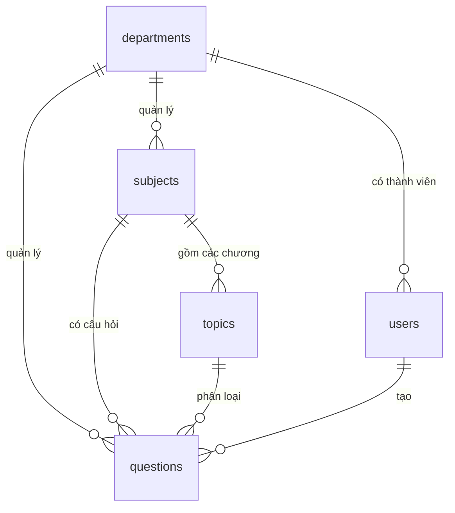
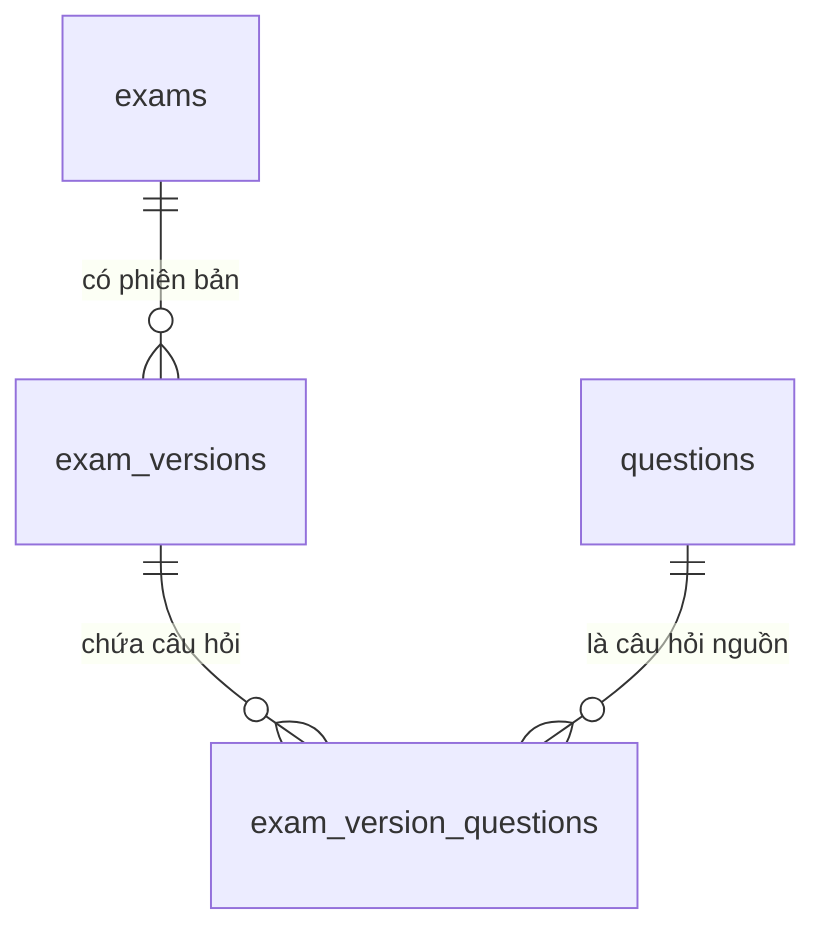
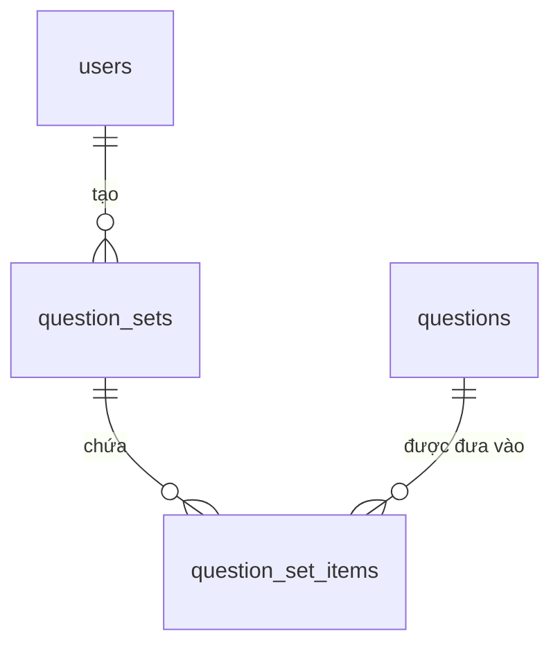
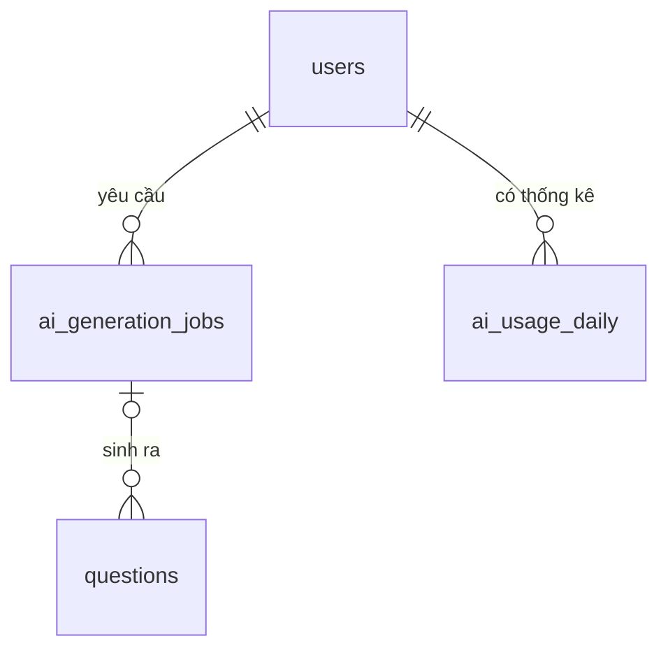
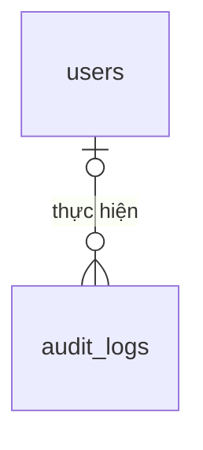

# AI Exam Maker — Database ERD

## Tổ chuyên môn, người dùng và danh mục

## Đề thi, phiên bản và câu hỏi trong đề

Khi gửi duyệt đề, mọi câu hỏi phải ở trạng thái `Approved`.
Hệ thống sao chép nội dung, đáp án, lời giải và điểm của từng câu
vào `exam_version_questions`. Bản sao này gọi là snapshot.

Ví dụ, nếu giáo viên sửa câu hỏi gốc sau khi gửi duyệt đề,
phiên bản đề đã gửi vẫn giữ nội dung đã chụp.

## Bộ câu hỏi

`question_set_items` nối bộ câu hỏi với các câu hỏi trong bộ.
Một câu hỏi có thể nằm trong nhiều bộ.

## Job AI và quota

Câu nhập tay có thể để trống `ai_job_id`. Với câu do AI sinh,
cặp `(ai_job_id, ai_ordinal)` phải duy nhất để worker chạy lại
không lưu trùng câu hỏi. `ai_usage_daily` lưu số job và số token
theo từng người dùng và ngày.

## Nhật ký audit

`audit_logs.actor_id` xác định người thao tác; NULL là hệ thống và note bắt buộc nêu tác vụ.
`entity_type` và `entity_id` xác định đối tượng bị tác động.
`department_id` (nullable, không FK) lưu snapshot tổ chuyên môn tại thời điểm ghi (chuyển giữa hai tổ khác NULL ghi hai dòng cho tổ cũ và tổ mới, dòng thứ hai đặt `is_secondary = true` để Admin không thấy trùng; lịch sử cũ trước migration của thực thể có thể đổi tổ hoặc đã xóa không resolve được tổ giữ NULL và chỉ Admin xem được; mọi nơi ghi audit mới phải set `DepartmentId` qua `AuditLog.Create`).
Mỗi lần đổi trạng thái lưu hành động, trạng thái trước,
trạng thái sau, ghi chú và thời điểm.

## Ràng buộc chính

- `users.cognito_sub` phải duy nhất. A4 bổ sung unique email qua `lower(btrim(email))` và `users.created_at` UTC.
- `questions.payload` là JSONB bắt buộc. Cấu trúc phụ thuộc vào
  `type` theo mục 8.2 trong `docs/context.md`.
- Mỗi đề có nhiều phiên bản. Cặp `(exam_id, version_no)` phải
  duy nhất và mỗi đề có tối đa một phiên bản `Published`.
- Khi gửi duyệt, mọi câu trong đề phải đang `Approved`.
  Nếu gửi duyệt lại sau khi bị từ chối, tạo snapshot mới
  và tính lại `content_hash`.
- Điểm dùng kiểu `numeric`. Tổng điểm các câu phải bằng
  `exam_versions.total_points`.
- Khóa ngoại `exam_version_questions.source_question_id`
  dùng `ON DELETE RESTRICT` để chặn xóa câu đang được đề tham chiếu.

  ## Cột và khóa của từng bảng

| Bảng | PK và FK | Các cột nghiệp vụ |
|---|---|---|
| `departments` | PK `id` | `name` |
| `users` | PK `id`; FK `department_id → departments.id` | `cognito_sub`, `email`, `full_name`, `role`, `is_active`, `created_at` |
| `subjects` | PK `id`; FK `department_id → departments.id` | `name` |
| `topics` | PK `id`; FK `subject_id → subjects.id` | `grade`, `name`, `sort_order` |
| `questions` | PK `id`; FK `department_id`, `subject_id`, `topic_id`, `ai_job_id`; `created_by` và `reviewed_by` trỏ đến `users.id` | `grade`, `type`, `difficulty`, `stem`, `payload`, `explanation`, `status`, `revision`, `source`, `ai_ordinal`, `ai_verification` và ghi chú, `ai_reviewed_by_author`, `submitted_at`, `reviewed_at`, `review_note`, thời điểm tạo/cập nhật |
| `question_sets` | PK `id`; FK `created_by → users.id` | `name` |
| `question_set_items` | PK ghép `(question_set_id, question_id)`; cả hai cột là FK đến bộ câu hỏi và câu hỏi tương ứng | — |
| `exams` | PK `id`; FK `subject_id`, `department_id`, `created_by → users.id` | `title`, `grade` |
| `exam_versions` | PK `id`; FK `exam_id → exams.id`; `reviewed_by` và `published_by` trỏ đến `users.id` | `version_no`, `status`, `duration_minutes`, `total_points`, `content_hash`, `submitted_at`, `reviewed_at`, `review_note`, `published_at` |
| `exam_version_questions` | PK ghép `(exam_version_id, sort_order)`; unique `(exam_version_id, source_question_id)`; FK `exam_version_id → exam_versions.id`, `source_question_id → questions.id` | `points`, `source_revision`, `type`, `difficulty`, `stem_snapshot`, `payload_snapshot`, `explanation_snapshot` |
| `ai_generation_jobs` | PK `id`; FK `requested_by → users.id` | `params`, `status`, `attempt`, `max_attempts`, `lease_expires_at`, `error_code`, `error_message`, `model_id`, `prompt_version`, `input_tokens`, `output_tokens`, `duplicates_dropped`, `created_at`, `last_enqueued_at`, `started_at`, `finished_at` |
| `ai_usage_daily` | PK ghép `(user_id, date)`; FK `user_id → users.id` | `jobs`, `tokens` |
| `audit_logs` | PK `id`; FK `actor_id → users.id` | `entity_type`, `entity_id`, `department_id`, `is_secondary`, `action`, `from_status`, `to_status`, `note`, `created_at` |

Chi tiết schema A2 nằm tại mục 8.1 trong `docs/context.md`. Snapshot được phép NULL khi Draft/Rejected; Application chụp nội dung khi Submit, trigger kiểm tra đầy đủ snapshot, nguồn Approved, tổng điểm và khóa nội dung đã đóng băng. Composite FK bảo đảm chương/môn/khối/tổ nhất quán. Đổi thứ tự câu bằng xóa/chèn lại dưới khóa version trong transaction; xóa bộ/câu phải gỡ question_set_items trước (FK RESTRICT). Các bảng `exams`, `exam_versions` có thêm `created_at`, `updated_at` theo API contract.
